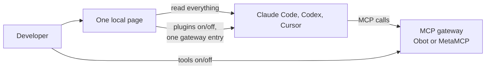

# Kitden

**One local page that shows what each AI coding client actually loads, where each item comes from,
and what loads twice, with safe on/off toggles.** Clients: Claude Code (including the Claude
Desktop Code tab), Codex and Cursor.

**Stage:** first release built (feature 001); results in
[validation](specs/001-agent-setup-inventory/validation.md). Feature 002 renamed the working
version, `agentsetup`, to Kitden. The repository name comes from the earlier gateway idea.



The page shows MCP servers, skills, plugins, hooks and marketplaces for every client, with the
source file and scope of each item, and points out cross-loading and duplicates. MCP tools are
managed in an existing gateway (gateway first): the page connects it to every client once and flags
MCP servers that bypass it. Writes happen only after an explicit "Apply" and can be undone.
A read-only "show my setup" MCP server gives agents the same answer. Team administration and
Langfuse export come later.

## Use it

Needs macOS and [uv](https://docs.astral.sh/uv/).

```bash
uv tool install .
```

Run this in the repository folder; it gives you the `kitden` command.

```bash
kitden
```

This opens the page in the browser and returns at once. If the page already runs, the same page
opens; only one runs at a time. A coding agent can run `kitden open` too. The page stops by itself
10 minutes after its last tab closes. To run it in the terminal instead, use `kitden serve` and
stop it with Ctrl+C (if a page already runs, `kitden serve` opens that one).

| I want to | On the page | What changes |
| --- | --- | --- |
| See what needs attention | **Overview** | Nothing |
| See what each client loads, here or in one project | **Load map** (pick a project in **Where**) → click a row for where it comes from | Nothing |
| Add my MCP gateway to all clients | **Gateway** → Add a gateway → Connect clients → Preview → Apply | One user-level entry per client; a key is stored only as a variable name |
| See MCP servers that go around the gateway | **Gateway** → the three groups below the diagram | Nothing |
| Remove an old direct MCP entry | **Load map** → row → Remove from … → Apply, or **Gateway** → Remove… | That entry |
| Turn a plugin on or off (Claude Code, Codex) | **Load map** → Plugins → row → Turn off in … / Turn on in … → Apply | The plugin's on/off flag |
| Install or move a plugin, add a marketplace | **Load map** → row → Commands… | Nothing: the page shows the command, you run it |
| Let agents see this setup | **show my setup** (bottom of the left rail) → Add… → Apply | One entry per client for `kitden mcp` |
| Undo a change | Undo in the note after Apply, or **Changes** → Undo | The previous file content comes back |

Other commands: `kitden scan --json` prints the same inventory and exits; `kitden mcp` is the
read-only server that clients start.

**Coming from `agentsetup`.** Kitden copies the old data folder once (gateways, history and Undo
carry over) and leaves the old folder as it is. If you added "show my setup" with the old version,
the page shows an "Old entry" card: use **Update to Kitden…** for each client. Then remove the old
tool:

```bash
uv tool uninstall agentsetup
```

**Safety.** Every change is shown first and written only after Apply. Before writing, the tool
saves a private backup (`~/Library/Application Support/kitden/changes`, kept for 30 days or the
last 100 changes). It stops if a file changed after the preview, reads the file again after
writing, and puts the backup back if the result is wrong. Undo stops if the file changed after the
change.

**Privacy.** The page answers only on `127.0.0.1` and needs the start link. Secret values are never
shown or logged, and the tool itself opens no network connections. One thing to know: to show the
on/off state of Codex remote plugins, it runs `codex plugin list --json`, and Codex then asks
chatgpt.com for your installed plugins.

## Start here

| Document | Purpose |
| --- | --- |
| [Project brief](docs/project-brief.md) | Product goal, users, success, first release scope, and open questions |
| [Feature 001 spec](specs/001-agent-setup-inventory/spec.md) | First release specification: user stories, requirements, success criteria |
| [Feature 002 spec](specs/002-kitden-rename/spec.md) | The Kitden name, `kitden open`, one page per computer |
| [Naming and licensing](docs/research/naming-and-licensing-2026-10-17.md) | How the name Kitden was chosen; license options |
| [Brief review](docs/research/brief-review-2026-10-17.md) | Independent review by two models: scores, missed competitors, recommended cuts, experiments |
| [Gateway trial](docs/research/gateway-trial-2026-10-16.md) | MetaMCP and Obot tested with Codex and agent-docs; cross-client setup research |
| [Gateway research](docs/research/mcp-gateway-landscape.md) | Existing MCP gateways, security practices, and reading list |
| [Design skills and tools](docs/research/design-skills-and-tools-2026-10-17.md) | Agent skills and tools for UI design and review, with risks and a proposed way of working |
| [Architecture proposal](docs/architecture/overview.md) | Gateway architecture from the earlier idea; superseded for the first release |
| [Constitution](.specify/memory/constitution.md) | Project principles, version 2.1.1 (amended 2026-10-18) |
| [Spec Kit workflow](docs/spec-kit-workflow.md) | Installed tooling and next development steps |

## Working language

Discuss work in simple Russian. Write code, UI text, and documentation in simple English.
Use diagrams and tables where they make the idea easier to understand.

## Approach

Do not build another MCP gateway: MetaMCP and Obot already cover tool access and blocking. This
tool is the narrow, read-first page from the [project brief](docs/project-brief.md). Its gap
against [Cross-Code Organizer](https://github.com/mcpware/cross-code-organizer), the closest
existing tool, is Cursor, plugins and marketplaces, and cross-client loading.

Built with Python 3.14, uv, Starlette and the official MCP SDK
([plan](specs/001-agent-setup-inventory/plan.md)). Research reviewed on **2026-10-16 and
2026-10-17**.
