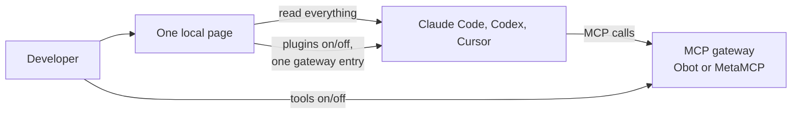

# MCP Gateway (working name)

**One local page that shows what each AI coding client actually loads, where each item comes from,
and what loads twice, with safe on/off toggles.** Clients: Claude Code (including the Claude
Desktop Code tab), Codex and Cursor.

**Stage:** research and project setup. There is no implementation yet.
The repository name comes from the earlier gateway idea; a new product name is an open question.

The page shows MCP servers, skills, plugins, hooks and marketplaces for every client, with the
source file and scope of each item, and points out cross-loading and duplicates. MCP tools are
managed in an existing gateway (gateway first): the page connects it to every client once and flags
MCP servers that bypass it. Writes happen only after an explicit "Apply" and can be undone.
A read-only "show my setup" MCP server gives agents the same answer. Team administration and
Langfuse export come later.

## Start here

| Document | Purpose |
| --- | --- |
| [Project brief](docs/project-brief.md) | Product goal, users, success, first release scope, and open questions |
| [Feature 001 spec](specs/001-agent-setup-inventory/spec.md) | First release specification: user stories, requirements, success criteria |
| [Brief review](docs/research/brief-review-2026-10-17.md) | Independent review by two models: scores, missed competitors, recommended cuts, experiments |
| [Gateway trial](docs/research/gateway-trial-2026-10-16.md) | MetaMCP and Obot tested with Codex and agent-docs; cross-client setup research |
| [Gateway research](docs/research/mcp-gateway-landscape.md) | Existing MCP gateways, security practices, and reading list |
| [Architecture proposal](docs/architecture/overview.md) | Gateway architecture from the earlier idea; superseded for the first release |
| [Constitution](.specify/memory/constitution.md) | Project principles, version 2.1.0 (amended 2026-10-17) |
| [Spec Kit workflow](docs/spec-kit-workflow.md) | Installed tooling and next development steps |

## Working language

Discuss work in simple Russian. Write code, UI text, and documentation in simple English.
Use diagrams and tables where they make the idea easier to understand.

## Current recommendation

Do not build another MCP gateway: MetaMCP and Obot already cover tool access and blocking.
Build the narrow, read-first page described in the [project brief](docs/project-brief.md).
Its gap against [Cross-Code Organizer](https://github.com/mcpware/cross-code-organizer), the
closest existing tool, is Cursor, plugins and marketplaces, and cross-client loading. Whether to
build an own tool or contribute to Cross-Code Organizer is still open.
No runtime, framework, or database is selected yet.

Research reviewed on **2026-10-16 and 2026-10-17**.
