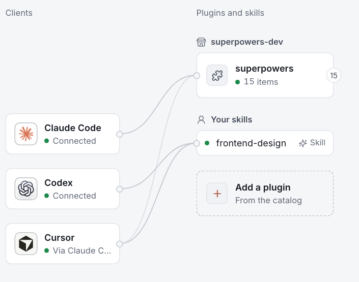
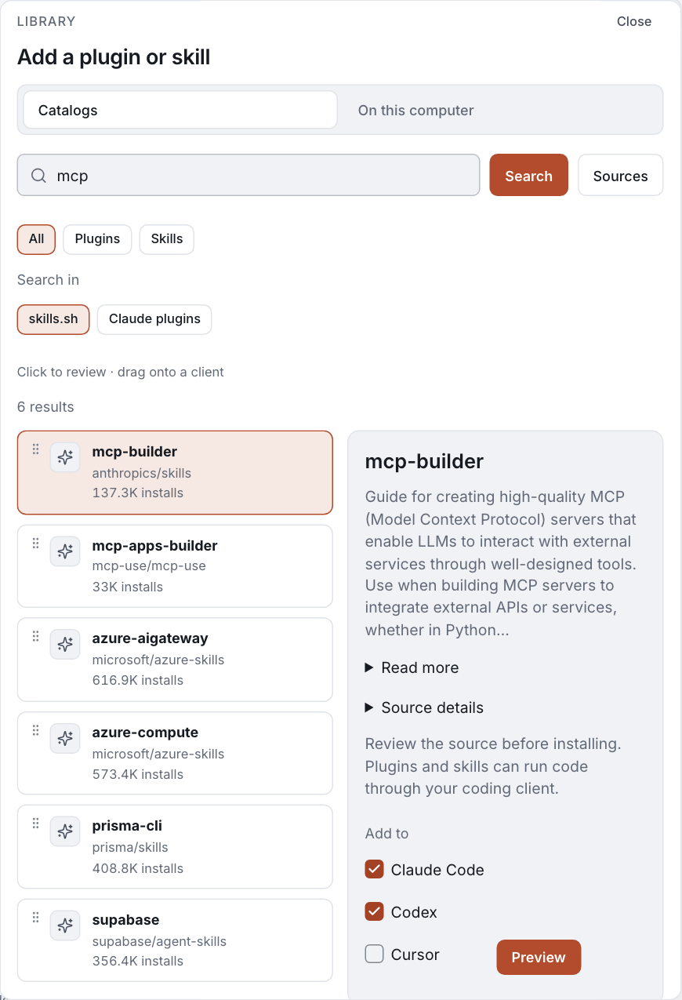

<h1 align="center">
  <picture>
    <source media="(prefers-color-scheme: dark)" srcset="docs/images/hero-dark.svg">
    <source srcset="docs/images/hero.svg">
    
  </picture>
</h1>

<p align="center"><strong>Your AI coding tools, under one roof.</strong></p>

<p align="center">See and share the MCP servers, plugins and skills<br>
that <b>Claude Code, Codex and Cursor</b> load.</p>

<p align="center">
  <a href="https://github.com/KonstantinStarovoytov/kitden/actions/workflows/release.yml"></a>
  <a href="https://github.com/KonstantinStarovoytov/kitden/releases/latest"></a>
  <a href="https://github.com/KonstantinStarovoytov/kitden/blob/main/LICENSE"></a>
</p>

<p align="center">
  <a href="https://glama.ai/mcp/servers/KonstantinStarovoytov/kitden"></a>
</p>

### Everything your agents load, on one map

Claude Code, Codex and Cursor each keep their own settings. Kitden puts their plugins, skills,
MCP servers and instruction files on one map, so what one agent has and another lacks shows
at a glance. Add what an agent is missing, turn an item off or remove it, on the same page.

<picture>
  <source media="(prefers-color-scheme: dark)" srcset="docs/images/readme/library-dark.png">
  <source srcset="docs/images/readme/library-light.png">
  
</picture>

### Find and add from one place

Search the official MCP Registry, skills.sh, the Claude plugins marketplace and any public
GitHub repository without leaving the page. Tick the agents a plugin or skill goes to. An MCP
server goes to the gateway, and says first whether it needs a sign-in or a token.

<picture>
  <source media="(prefers-color-scheme: dark)" srcset="docs/images/readme/find-dark.png">
  <source srcset="docs/images/readme/find-light.png">
  
</picture>

### One gateway for your MCP servers

Move a server into the Kitden gateway and every agent you use gets it: set it up once, not
once per agent. Every tool has a switch, for all projects or one, and a tool that is off is
refused, not just hidden. A token or sign-in is given once and checked before Apply.

<picture>
  <source media="(prefers-color-scheme: dark)" srcset="docs/images/readme/tools-dark.webp">
  <source srcset="docs/images/readme/tools-light.webp">
  
</picture>

### Every change can be undone

- **Nothing is written until you press Apply.** Every change shows a preview first, with
  the exact edit under Show changes.
- **Apply keeps a backup, and Undo puts it back.** Changes keeps the history of what you
  did. If a file changed since, Kitden stops instead of overwriting it.
- **Everything stays on your computer.** The page runs at 127.0.0.1 behind a private link. No
  account, no telemetry. Kitden goes online only for the catalogs you open and the remote
  servers you add.
- **Secrets live in the macOS Keychain or your Linux keyring only.** The page shows no more
  than their first and last characters.
- **Kitden's agent tools only read.** Asking an agent to show your setup changes nothing.

Add only servers and plugins you trust: they run with your permissions.

## And more

| Feature | What it does |
| --- | --- |
| **Per project** | Turn a server or a tool on or off for one project only. |
| **See what runs** | How often each tool is called, and which tools only read. |
| **Instructions in view** | Which CLAUDE.md, AGENTS.md, rules, hooks, commands and agents each client loads, and where they come from. |
| **Ask your agent** | "Show my setup" works from any agent, through Kitden's own read-only MCP server. |
| **Claude Code plugin** | With Kitden installed, `/plugin install kitden --marketplace KonstantinStarovoytov/kitden` adds its skill and read-only tools to Claude Code. Codex has [one too](https://github.com/KonstantinStarovoytov/kitden/blob/main/plugins/kitden/README.md). <!-- Checked 2026-11-05: https://code.claude.com/docs/en/discover-plugins --> |

## Get started

Needs **macOS or Linux**, [uv](https://docs.astral.sh/uv/getting-started/installation/) and at
least one of **Claude Code, Codex or Cursor**. On Linux, install `libsecret-tools` (Debian,
Ubuntu) or `libsecret` (Fedora, Arch) so Kitden can keep server secrets in your keyring.

Try it on a sample first. Your own settings are not read or changed:

<!-- Release checklist: docs/readme-media.md -->
```bash
uvx --python 3.13 kitden demo
```

Install it and open it for your own setup:

```bash
uv tool install --python 3.13 kitden && kitden
```

Or with Homebrew: `brew install konstantinstarovoytov/tap/kitden`, then `kitden`.

Update later with `uv tool upgrade kitden` or `brew upgrade kitden`.

[Guide](https://github.com/KonstantinStarovoytov/kitden/blob/main/docs/guide.md) ·
[Roadmap](https://github.com/KonstantinStarovoytov/kitden/blob/main/ROADMAP.md) ·
[Releases](https://github.com/KonstantinStarovoytov/kitden/releases) ·
[Issues](https://github.com/KonstantinStarovoytov/kitden/issues) ·
[Contributing](https://github.com/KonstantinStarovoytov/kitden/blob/main/CONTRIBUTING.md) ·
[Apache-2.0](https://github.com/KonstantinStarovoytov/kitden/blob/main/LICENSE)
<!-- mcp-name: io.github.KonstantinStarovoytov/kitden -->
