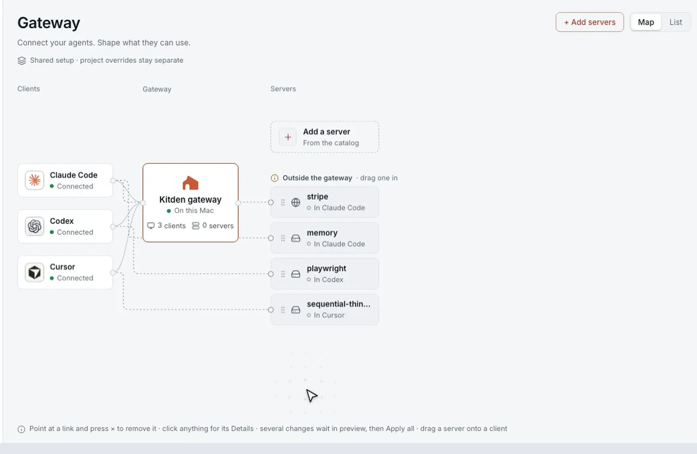
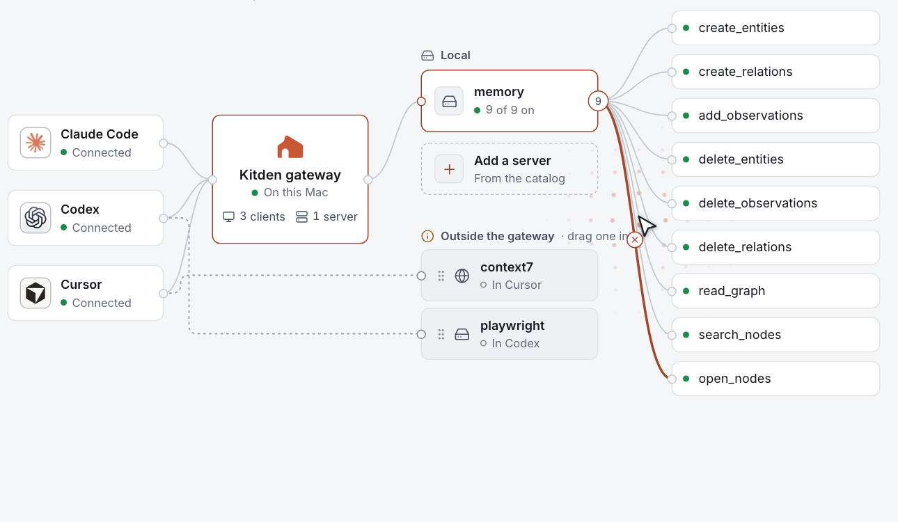
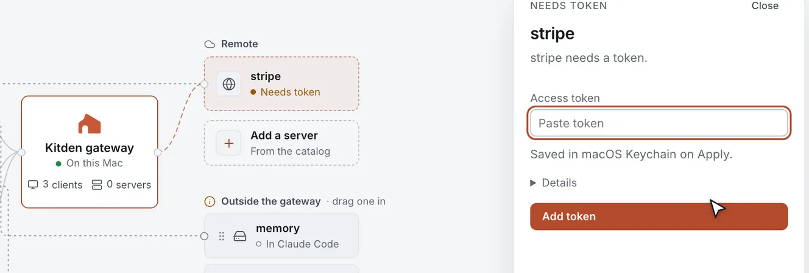

<h1 align="center">
  <picture>
    <source media="(prefers-color-scheme: dark)" srcset="docs/images/hero-dark.svg">
    <source srcset="docs/images/hero.svg">
    
  </picture>
</h1>

<p align="center"><strong>Your AI coding tools, under one roof.</strong></p>

<p align="center">See and share the MCP servers, plugins and skills<br>
that <b>Claude Code, Codex and Cursor</b> load.</p>

<p align="center">
  <a href="https://github.com/KonstantinStarovoytov/kitden/actions/workflows/release.yml"></a>
  <a href="https://github.com/KonstantinStarovoytov/kitden/releases/latest"></a>
  <a href="https://github.com/KonstantinStarovoytov/kitden/blob/main/LICENSE"></a>
</p>

### Move many at once

<picture>
  <source media="(prefers-color-scheme: dark)" srcset="docs/images/readme/pick-dark.webp">
  <source srcset="docs/images/readme/pick-light.webp">
  
</picture>

### Turn tools off

<picture>
  <source media="(prefers-color-scheme: dark)" srcset="docs/images/readme/tools-dark.webp">
  <source srcset="docs/images/readme/tools-light.webp">
  
</picture>

### One token, every agent

<picture>
  <source media="(prefers-color-scheme: dark)" srcset="docs/images/readme/token-dark.webp">
  <source srcset="docs/images/readme/token-light.webp">
  
</picture>

## Get started

Needs macOS and [uv](https://docs.astral.sh/uv/getting-started/installation/).
Try it on a sample first. Your own settings are not read or changed:

<!-- Release checklist: docs/readme-media.md -->
```bash
uvx --python 3.13 kitden demo
```

Then install it for your own setup and open it:

```bash
uv tool install --python 3.13 kitden && kitden
```

Every change shows a preview first, keeps a backup for Undo, and stays on your Mac.
Secrets live in the macOS Keychain. Add only servers and plugins you trust: they run with
your permissions.

[Guide](https://github.com/KonstantinStarovoytov/kitden/blob/main/docs/guide.md) ·
[Roadmap](https://github.com/KonstantinStarovoytov/kitden/blob/main/ROADMAP.md) ·
[Releases](https://github.com/KonstantinStarovoytov/kitden/releases) ·
[Issues](https://github.com/KonstantinStarovoytov/kitden/issues) ·
[Contributing](https://github.com/KonstantinStarovoytov/kitden/blob/main/CONTRIBUTING.md) ·
[Apache-2.0](https://github.com/KonstantinStarovoytov/kitden/blob/main/LICENSE)
