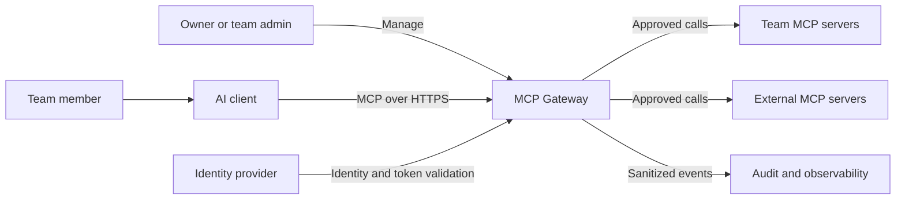
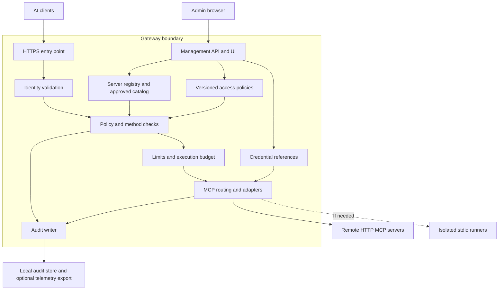
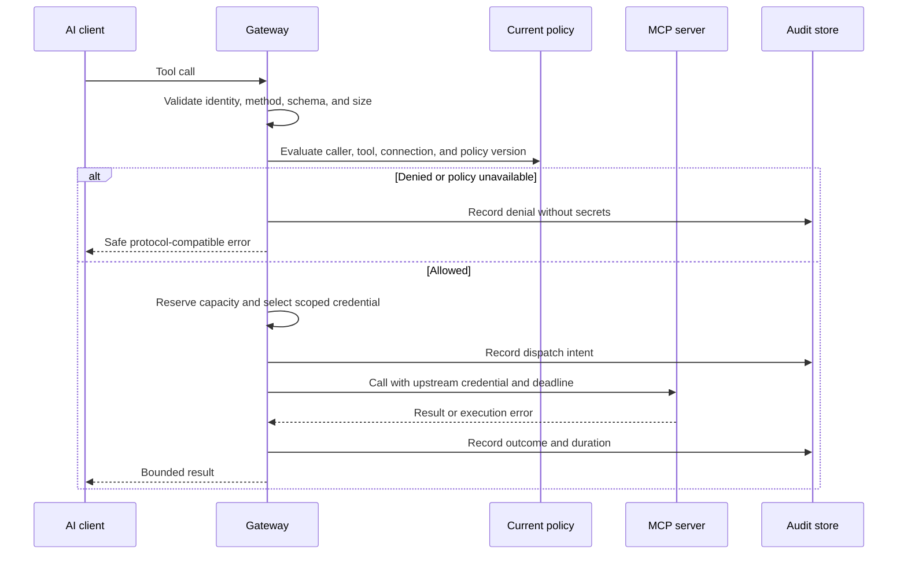
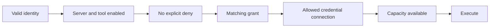

# Architecture proposal

Date: 2026-10-16. Status: **superseded on 2026-10-17**. This document describes the earlier
MCP gateway idea. The product is now a local tool for AI coding client setups; see the
[project brief](../project-brief.md). Kept as reference for connecting an existing gateway.

## Goal and constraints

Give one owner and a small team one controlled way to use their MCP servers.
Start on one self-hosted server. Keep access rules understandable and operations manageable.
The runtime, database, identity provider, transport support, and capacity targets are still open.

This is an original design proposal informed by the [research](../research/mcp-gateway-landscape.md).
The diagrams use C4-style boundaries; they do not prescribe microservices.

## System context



The gateway is an MCP server to clients and an MCP client to upstream servers.
It governs traffic that passes through it. The surrounding network and upstream credentials
must prevent a privileged bypass where centralized enforcement is required.

## Logical building blocks



Management changes configuration. The request path enforces it. These may share one application
in a custom build, or the management application may configure an existing gateway engine.
Use one authoritative policy store and atomic policy versions; avoid two independent rule systems.

Suggested starting deployment: HTTPS entry point, gateway/application, and durable storage on
one server. Add a separate runner only if executable MCP servers are required. Add distributed
coordination only when more than one request-handling instance is needed. Backup and restore
must cover configuration and encrypted credentials, with encryption keys managed separately.

## Request flow



Admission failures from identity validation, overload, or missing credentials also produce safe
errors and minimal audit events. If a required dispatch audit record cannot be stored, fail
closed before calling the upstream. If the process fails after dispatch, the stored intent may
have an unknown outcome; never claim exactly-once execution or silently replay it.

Optional telemetry export can buffer within a bound and report export failures. It must not
become an unbounded memory queue or an implicit dependency on an external cloud service.

## Identity and policy model

| Concept | Meaning |
| --- | --- |
| Principal | A person or service identity authenticated at the gateway |
| Client identity | The application acting for that principal, where reliably available |
| Server | A registered MCP endpoint or managed executable |
| Connection | Access to one server with a specific credential owner and scope |
| Tool identity | Stable mapping of server identity and upstream tool name |
| Grant | Explicit permission for a principal or role to use a tool/connection |
| Policy version | The configuration revision used for a decision |

Admin/member roles govern management permissions. Tool grants govern execution separately;
an admin role does not silently authorize every tool call. A shared service account must be
explicitly labeled because its upstream privileges can be wider than a member's own privileges.

Proposed policy order:



Every failed check stops dispatch. Listing tools applies the same identity and grant model;
calling a tool always rechecks current policy. Changed schemas and descriptions go back to
review rather than silently inheriting approval. Catalog refresh must preserve stable names.

Credentials belong to the gateway's secure connection store, never to a tool description.
Separate the token presented to the gateway from the credential used for an upstream.
Use standards-based exchange or a stored authorized connection where appropriate.
See [MCP authorization](https://modelcontextprotocol.io/specification/2026-07-28/basic/authorization)
and [OAuth security](https://www.rfc-editor.org/rfc/rfc9700.html).

## Protocol and load boundaries

| Area | Proposed behavior |
| --- | --- |
| Protocol versions | Explicit tested matrix; support legacy sessions only for clients that require them |
| Transport | HTTP first if actual servers allow it; isolate stdio execution when needed |
| Non-tool methods | Advertise only implemented capabilities; authorize resources/prompts if enabled; reject unsupported methods |
| Pagination | Filter every page; bind aggregate cursors to identity and policy context |
| Cache | Cache server metadata carefully; avoid shared authorization-sensitive responses and tool results by default |
| Revocation | Apply to every new admission after the change is acknowledged; do not claim to undo completed effects |
| In-flight disable | Attempt cancellation only where supported; record whether the upstream outcome is unknown |
| Limits | Separate per-principal rate, per-upstream concurrency, global concurrency, size, and execution deadline |
| Overload | Reject predictably with the tested MCP/HTTP error mapping; do not assume every tool-level denial is HTTP 429 |
| Retries | No generic retries for tool writes; cancellation and timeout do not prove an action did not happen |
| Failure isolation | Saturation or failure of one upstream does not consume every execution slot |
| Scaling later | Coordinate quota and revocation state across replicas before adding them |

Current protocol reference: [MCP 2026-07-28](https://modelcontextprotocol.io/specification/2026-07-28).
Load-control reference: [Google SRE](https://sre.google/sre-book/handling-overload/).

## Admin experience

Use a clear list/detail interface, with a topology view as an optional aid.
The first screen should answer: what is connected, what is allowed, and what needs attention?
Use [Carbon's data-table patterns](https://carbondesignsystem.com/components/data-table/usage/)
as a reference for filtering, expandable detail, and scoped actions.

```text
MCP Gateway
|
+-- Servers       Status, endpoint, owner, protocol, last check
|   +-- Details   Connection test, credentials, discovered tools, disable
+-- Tools         Server, effective access, changed definition, limits
|   +-- Details   Schema, grants, policy explanation, recent outcomes
+-- Access        Members, roles, client identities, tool grants
+-- Activity      Caller, tool, allowed/denied, reason, duration, outcome
+-- Settings      Identity, retention, export, backup, default limits
```

Original wireframe proposal, with illustrative data only:

```text
Tools                                      Search tools...   Server: All
------------------------------------------------------------------------
Tool              Server        Effective access       Reason
docs_search       Team Docs     Allowed                Team reader grant
repo_delete       Source Repo   Blocked                Explicit deny
export_report     Reports       Review needed          Definition changed
------------------------------------------------------------------------
Selected: repo_delete
Who: member@example.com    Decision: blocked    Policy: revision 12
Matched rule: destructive tools denied
Actions: View rule | View recent calls
```

Show effective access for a selected identity, not just an enabled switch. Distinguish disabled,
unreachable, unauthorized, overloaded, and awaiting review. A policy preview must be labeled
as a preview; the server still decides each real call. Preserve keyboard navigation and pair
status colors with text. Never display saved secret values after creation.

## Decisions to record

Use short records based on [ADR guidance](https://adr.github.io/): context, options, decision,
consequences, and evidence. No engine-selection decision has been accepted yet.

| Decision | Options or evidence needed |
| --- | --- |
| Gateway base | ContextForge, agentgateway plus management, or custom SDK-based gateway |
| Client compatibility | Named clients, supported versions, HTTP and stdio needs |
| Identity model | Login provider; user delegation versus shared service connections |
| Durable state | Engine requirements, operational familiarity, backup/restore behavior |
| Audit and telemetry | Local retention, reader permissions, optional export destination |
| Capacity | Representative workload and measured resource envelope |

Use [C4](https://c4model.com/) to evolve the diagrams and [arc42](https://arc42.org/overview/)
to expand this document only when a section answers a real engineering question.
