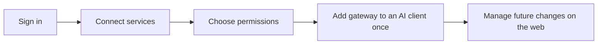
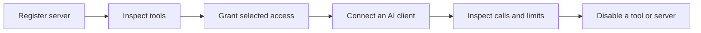

# Project brief

Date: 2026-10-16. Status: discovery brief, not a completed feature specification.

## Product goal

**Connect the gateway once in each AI client. Manage personal MCP connections, credentials,
and tool permissions through one simple web interface.**

The owner's proposed product is a personal MCP hub for a self-hosted small-team installation.
It addresses repeated client configuration and scattered access management. Product value
comes from a reliable connection experience and understandable permissions. A policy laboratory
is not part of the proposed first release. The owner already has Langfuse; a second tracing
platform is not a product goal.

## Confirmed by the owner

| Topic | Requirement |
| --- | --- |
| Audience | The owner and a small team |
| Hosting | Their own server |
| Connections | Add and manage their own MCP servers |
| Access | Central authentication and tool allow/deny controls |
| Operations | Security, load control, and visibility |
| Process | Use GitHub Spec Kit; research before implementation |
| Communication | Simple Russian in conversation |
| Project language | Simple English for development and documentation |
| Explanation | Prefer visuals |
| Named research reference | LangSmith |
| Existing observability | Langfuse |
| Product experience | Web sign-in, MCP catalog, Connect actions, credentials, tool permissions |
| Client configuration | One gateway connection per AI client; later server changes happen in the web UI |
| Reusable credentials | Store credentials once and reuse them for explicitly authorized compatible connections |

## Proposed connection experience

1. Sign in with one supported identity provider. GitHub and Google are candidates, not selected dependencies.
2. Open a catalog of supported MCP integrations or add a custom endpoint.
3. Click Connect. Complete the upstream service's consent flow or supply the required credential.
4. Choose enabled tools and supported access restrictions.
5. Add the gateway endpoint to an AI client and authenticate that client to the same gateway account.
6. The client discovers the tools enabled for that identity. Later changes do not require editing
   individual upstream server configurations in the client.
7. Disable a connection or tool from the web UI. The gateway blocks new calls even if the client
   still displays an old tool list.

## Important product boundaries

| Topic | Product behavior |
| --- | --- |
| Identity | Web login and MCP client authorization map to the same internal user; a browser cookie or an email in a URL is not sufficient |
| Service consent | Signing in with Google or GitHub does not automatically authorize access to Gmail, Drive, or repositories |
| Credentials | Personal by default; reuse requires an explicit binding to a compatible service and connection |
| Model keys | Can support managed tools that call that model provider; arbitrary external MCP servers do not automatically accept them |
| Agent's own model | Configuring MCP does not change the coding client's model provider or billing; model routing is separate scope |
| Refresh | Support client-specific tool refresh; offer a reconnect instruction when needed; do not promise instant refresh in every client |
| Local access | A remote gateway cannot automatically reach files or processes on the user's laptop; local servers need a separate bridge or runner |
| Permissions | Enforce gateway tool grants on every call; service-specific resource restrictions need supported upstream scopes or validated adapters |
| Isolation | User A must never inherit user B's tools, OAuth grants, credentials, or cached catalog |

Compatibility evidence reviewed on 2026-10-16: [Claude Code documents dynamic tool updates](https://code.claude.com/docs/en/mcp#dynamic-tool-updates).
[OpenAI documents MCP client authorization](https://developers.openai.com/plugins/build/auth).
The exact target products and versions still require end-to-end testing; OpenAI is a vendor,
so Codex, ChatGPT, and API-based clients must be evaluated separately.

## Proposed first release

These boundaries are recommendations for specification, not additional confirmed requirements.

| Include first | Defer unless a real use case requires it |
| --- | --- |
| One team and one installation | Public SaaS and tenant billing |
| Register existing HTTP MCP endpoints | Running arbitrary uploaded code |
| Approved tool catalog with stable names | Semantic search over thousands of tools |
| Admin and member roles; separate client identities | Complex organization hierarchies |
| Enforced tool allow/deny and credential revocation | General agent orchestration |
| Per-client and per-server limits; timeouts | Multi-region high availability |
| Audit trail, latency, errors, active calls | Mandatory cloud telemetry |
| Personal connection catalog and a simple management UI | Public marketplace publishing and billing |
| Explicit credential reuse for supported integrations | Automatic credential injection into arbitrary third-party servers |

Local stdio servers are conditional scope. If the owner's first servers require them,
include an isolated runner in the first release rather than pretending HTTP covers the need.

## First acceptance scenario to specify

1. User A signs in, connects one supported service, and enables selected tools.
2. User A configures the gateway in a supported AI client and authenticates to their account.
3. User A connects a second service through the web UI without editing the client's server configuration.
   Tool refresh follows the tested client behavior; duplicate tool names remain unambiguous.
4. User B sees only B's authorized tools. A direct request for a hidden tool fails before reaching its server.
5. User A disables an allowed tool. The next admitted call fails, including from a client
   that cached the old catalog. An already running call follows an explicit cancellation policy.
6. A slow server reaches its concurrency limit without exhausting the gateway or the other server.
7. The admin can identify the caller, decision, tool, duration, and outcome without reading secrets.

## Decisions needed before a technical plan

| Question | Why it matters | Working proposal |
| --- | --- | --- |
| Which first 2–3 MCP servers? | Establishes transport, credential, and isolation needs | Use actual owner workloads |
| Which AI clients and versions? | Establishes protocol and OAuth compatibility | Test a named client matrix |
| Which services need shared credentials? | Defines exceptions to personal ownership | Personal credentials by default; explicit sharing only |
| Which login provider? | Avoids building an authorization server | Reuse a compatible existing provider |
| Existing engine or custom implementation? | Sets maintenance cost and product freedom | Compare ContextForge and agentgateway |
| Server resources and expected concurrency? | Sets useful capacity targets | Measure a representative workload |
| Public endpoint or private network? | Defines ingress, discovery, and operational exposure | Keep management access restricted |

No performance target, budget, timeline, or implementation language has been agreed.
