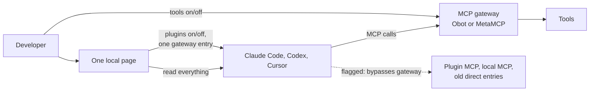

# Project brief

Date: 2026-10-16, updated 2026-10-17. Status: **approved by the owner on 2026-10-17**, including
the items labeled Proposed below (scope, calls and anti-goals). Open questions stay open.
On 2026-10-17 the owner asked to narrow the scope following the
[independent review](research/brief-review-2026-10-17.md). The earlier "personal MCP hub" brief
is kept in [the archive](archive/2026-10-16-personal-mcp-hub-brief.md).
Later on 2026-10-17 the owner chose **gateway first**: MCP tools are managed in an MCP gateway
(Obot or MetaMCP), not in each client's files.

Labels used below: **Confirmed** = the owner said it. **Proposed** = Claude's suggestion,
not yet confirmed. **Fact** = checked against a source or a local test, with a date.

## Product goal

**Long-term goal (Confirmed):** one local page where a developer sees and manages everything their
AI coding agents can use, across Claude Code, Claude Desktop, Codex and Cursor.

**First release focus (Proposed, from the review):** show what each AI coding client actually
loads, where each item comes from, and what loads twice. Let the developer turn plugins on and off
safely. MCP tools are managed in the gateway; the page connects the gateway to every client and
shows which MCP servers go around it. (Gateway first: Confirmed 2026-10-17)

## Why

Each client has its own settings, folders, plugin marketplaces and MCP configuration.
Since 2026 the clients also read each other's skills, plugins, hooks and marketplaces, so it is
hard to know what an agent really loads and from where. (Confirmed pain; Fact for cross-reading)

Main pain (Confirmed): "I cannot see what is installed and enabled where in different clients".

The moment that showed the pain (Confirmed): during a job interview, the owner could not
open a project in Claude Code, then could not reference a folder with `@` because it was
missing from the dropdown. The owner had to copy and paste paths by hand, under time pressure.

## Who

| Priority | User | Need |
| --- | --- | --- |
| First | Developer on their own computer | See and control their own agent setup (Confirmed) |
| Later | Team admin | One set of plugins, skills, agents and MCP servers for the team (Confirmed as a later need). Vendors and Obot already cover much of this |

## Position against existing tools (Fact, 2026-10-17)

| Tool | Covers | Does not cover |
| --- | --- | --- |
| [Cross-Code Organizer](https://github.com/mcpware/cross-code-organizer) (closest) | Local `npx` dashboard for Claude Code and Codex CLI: effective state per project, duplicates, moves, MCP off per project, undo, backups | Cursor, Claude Desktop, plugin and marketplace management |
| mTarsier, Claude Code Tool Manager | MCP servers and skills across several clients, with backups | Plugins, marketplaces, effective state |
| Codex and Claude Code `/import` | Copy one client's setup into another | A view of what is installed where |
| Obot and Obot Sentry | Team governance; device inventory documented but stubbed in the README; needs a server | Local writes, single-developer use |

**Our gap:** Cursor + plugins and marketplaces + cross-client loading ("who loads what, from where,
and twice") in one page, with safe toggles.

**Relation to MCP gateways (gateway first, Confirmed 2026-10-17):** the gateway (Obot or MetaMCP)
is where MCP tools are added, turned on and off, and protected. Each client needs only one gateway
entry. The page works on the laptop: it connects the gateway to every client once, and it handles
what a gateway cannot reach: plugins, skills, hooks, marketplaces, MCP servers bundled in plugins,
local MCP servers that must run on the laptop, and old direct entries. The page does not replace or
build a gateway.

| What | Managed in |
| --- | --- |
| MCP tools that go through the gateway | The gateway's own interface |
| One gateway entry per client | Our page (connect once) |
| MCP servers that bypass the gateway | Our page shows them and how to move them; removing an old direct entry is a reversible write |
| Plugins, skills, hooks, marketplaces | Our page (see and, for plugins, turn on or off) |

## Success

**Product vision (owner's words, Confirmed):** the owner does not open Customize in Codex, Cursor or
Claude; sees all marketplaces; moves plugins between Cursor and Claude; sees where each plugin or
MCP server applies; manages MCP servers from one interface; turns on logs to Langfuse or LangSmith.

**First release success (Proposed):**

- For any project, the owner sees in under 30 seconds what each client loads: MCP servers, skills,
  plugins, hooks and marketplaces, with the source file and scope of each item.
- The page points out items that load twice, including items one client reads from another
  client's folders.
- The owner connects the gateway to all clients once and sees every MCP server that goes around it.
- The owner turns a plugin on or off without editing files and can undo it.
- In any agent session, the owner can ask "show my setup" and get the same answer.

## First release scope (Proposed, from the review)

| In the first release | Not in the first release, and why |
| --- | --- |
| **Inventory with provenance** for Claude Code (including the Claude Desktop Code tab), Codex and Cursor: MCP servers, skills, plugins, hooks, marketplaces, scopes, and the projects each client knows. Items that cannot be seen are labeled "unknown" | Claude Desktop chat and Cowork plugins and connectors: they live in the account, not in local files |
| **Effective view per project**: what each client really loads there | Explaining a missing `@` folder: separate research, candidate for later |
| **Duplicates and cross-loading**: the same item in two places, and one client loading another client's items | — |
| **Connect the gateway to all clients** (Confirmed 2026-10-17): add one MCP gateway URL (Obot, MetaMCP or any MCP endpoint) to Claude Code, Codex and Cursor in one action. Link to the gateway's own interface for tools on/off. If the gateway needs a login, show the client's login command (for example `codex mcp login`). Gateway keys go in as environment variable references, never as plain text | Building our own gateway: MetaMCP and Obot already exist |
| **MCP servers that bypass the gateway** (gateway first, Confirmed 2026-10-17): flag every MCP server that does not go through the gateway (plugin MCP, local MCP, old direct entries), with its source. Remove an old direct entry after its tools are in the gateway, as a reversible write | Adding, turning on or off individual MCP servers in client files: done in the gateway instead. Moving a server into the gateway automatically: the page shows how; the gateway's interface does it |
| **Plugins**: turn on or off in Claude Code and Codex. Cursor: shown first; turned on or off only after a spike proves the write is reliable (Confirmed) | Installing, updating or moving plugins and adding marketplaces: vendor CLIs and `/import` already do this. The page shows the exact vendor command instead |
| **Safe writes**: only after an explicit "Apply"; backup before, verify after, undo | Automatic sync at every session start: hidden writes conflict with the anti-goals |
| **Read-only MCP server "show my setup"**, added to a client with one `mcp add` | Our own plugin with hooks |
| **Rescan** on file changes and on a button | Langfuse or LangSmith export: a documentation snippet only; a feature later |
| — | Team server: later, likely through vendors' team features or Obot |

## How it is made

- A local web page on `localhost`, started with **one command** (Confirmed).
- Screen and visual design is a separate task (Confirmed).
- No login for local use (Confirmed).
- Writes go through each client's own CLI where one exists, otherwise through documented
  config keys (Proposed).
- macOS first (Proposed).

## Install and use (Proposed; replaces the earlier hook and plugin flow)

1. Run one command. It starts the local page and opens the browser.
2. The page scans the clients and shows the inventory. Nothing is written.
3. The owner enters the gateway address once; the page adds it to every client after "Apply".
4. Optional: the page offers to add the read-only "show my setup" MCP server to each client.
   It shows the exact command and runs it only after the owner says yes.
5. Changes happen only after "Apply". Each change is backed up and can be undone.

## Team version (later)

A team server cannot edit files on a laptop. If a team version is built, a server would keep the
desired set and the local program would apply it and report back. Strict rules come from each
vendor's managed settings, usually on paid team plans. Before building this, check whether
vendors' team features or Obot already meet the need. (Proposed)

## Anti-goals (Proposed: Claude's guesses, owner to correct)

The product fails, even if it technically works, when it:

- breaks a client's configuration or loses settings. Every write must be reversible;
- writes anything without an explicit action by the owner;
- shows a secret value, or sends local inventory anywhere without explicit opt-in;
- looks complete but silently misses things. It must label what it cannot see;
- turns into another gateway that all agent traffic must pass through.

## Constraints and known risks (Fact, 2026-10-16 to 2026-10-17)

| Topic | What we know |
| --- | --- |
| Config locations | Claude Code: `~/.claude.json`, `.mcp.json`, settings files with `enabledPlugins`, `~/.claude/plugins/`. Codex: `~/.codex/config.toml` and trusted-project configs. Cursor: `~/.cursor` and `.cursor`. Claude Desktop: `claude_desktop_config.json` plus account-side connectors and plugins |
| Cross-client reading | Codex reads Claude and Cursor marketplace layouts (verified in Codex source). Cursor reads Claude skills and hooks and loads skills from the Claude Code, Codex and `.agents` folders. The Cursor CLI lists plugins imported from Claude Code next to native ones (changelog, 2026-05-07) |
| Plugin on/off state | Claude Code: `enabledPlugins` and `claude plugin enable/disable`. Codex: `[plugins."name@marketplace"] enabled` in `config.toml`; some curated app plugins have no local entry. Cursor CLI: `enabled_plugins` in `~/.cursor/settings.json` (changelog, 2026-05-20). Cursor IDE: unverified |
| Config rewrites | `codex mcp add` rewrites the whole `config.toml`: comments are dropped, sections reordered, empty keys removed. Our writes must survive this |
| Vendor change rate | Very high: Claude Code and Codex release several times a week; Cursor CLI about weekly. Parsers need ongoing upkeep |
| Account-side state | Some state lives in vendor accounts and is not visible in local files |
| Gateway cost | Obot needs a Docker socket or Kubernetes and stores credentials unencrypted unless an encryption provider is set; MetaMCP is lighter but its published image is old. Each client logs in to an OAuth gateway itself; the Codex login waits only a few minutes |
| What a gateway cannot reach | MCP servers bundled in plugins, and local MCP servers that need the laptop (for example computer use or local apps), keep running directly |

## Claude's calls (owner to check)

| Topic | Decision |
| --- | --- |
| Duplicates | The same item in two clients is information. One client loading the same item twice is a warning |
| Secrets | The page never shows secret values. A gateway key is written as an environment variable reference, never as plain text. Inline secrets in existing entries are flagged |
| Project-scope writes | Default to private user or local scope. Clearly label writes to files that are usually committed to git, such as `.mcp.json` and `.cursor/` |
| Architecture shape | The part that reads and writes client files is a separate local component with its own API, so a team server could use it later |
| Cursor spike | The first engineering task is to find and test Cursor's plugin on/off storage, including after a restart |

## Left to the builder

- Technology stack, chosen in the Spec Kit plan step.
- Internal data model for the inventory.
- How file changes are detected.

## Open questions

| Question | Why it matters |
| --- | --- |
| Product name | "MCP Gateway" no longer describes the product |
| Admin layer: build it or rely on vendor team features and Obot? | Only matters for the later team version |

## Effect on other project documents

- The [constitution](../.specify/memory/constitution.md) was amended to version 2.0.0 on
  2026-10-17 to match this brief, and to 2.1.0 the same day for gateway first.
- Own tool versus a Cross-Code Organizer contribution was decided in planning: own tool
  ([research R1](../specs/001-agent-setup-inventory/research.md#r1-own-tool-or-contribution-to-cross-code-organizer)).
- The [architecture proposal](architecture/overview.md) describes a gateway and is marked superseded.
- Research documents stay as evidence.
