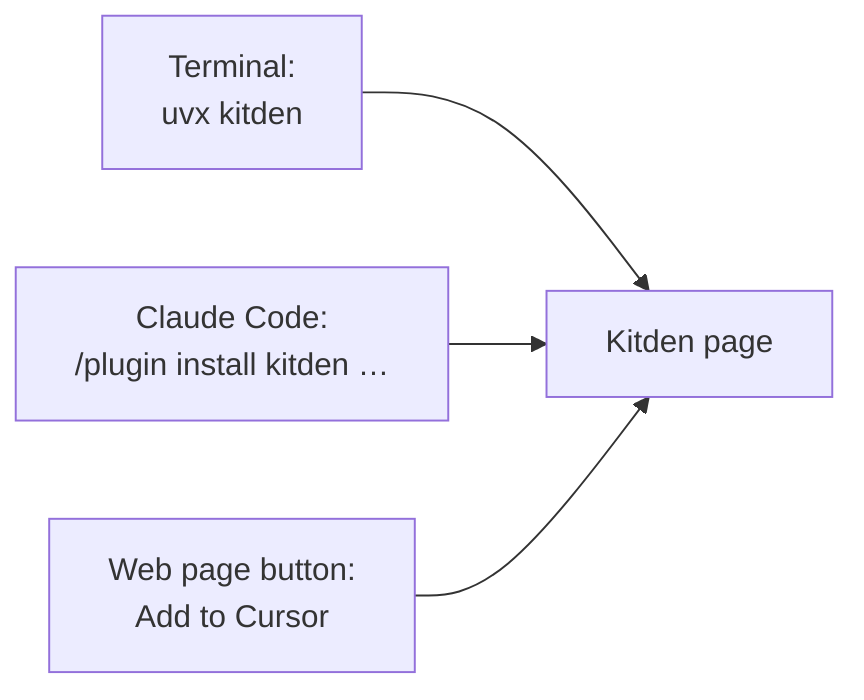

# Design and install review

Reviewed: 2026-10-18. Status: review results and proposals, not decisions.

The owner asked two questions: is the page simple, easy, intuitive, free of noise and
pleasant; and how can people install and use Kitden with the least effort, from any OS and
any coding agent.

## Part A: design

Method: nine screenshots of the real page on a test home (desktop light and dark, the side
panel, a review, every place, phone width), judged by the author and by a reviewer model that
had never seen the page. Scores are the reviewer's; the author agrees with them.

| Goal | Score (1–5) | Why |
| --- | --- | --- |
| Simple to understand | 3 | Four places are clear; the cards explain problems with file paths and words like "6 around" need decoding |
| Easy to use | 3 | Row → panel → review → Apply works; some buttons do not match the problem shown |
| Intuitive | 3 | Status shapes read well; "Show", the "Undone" badge and "Remove…" on Gateway mislead |
| No extra information | 2 | Counters, legend, host:port, diff headers, the same fact in three places |
| Pleasant and modern | 3 | Calm and consistent in both themes, but dense grey text and every button looks the same |

### Problems, by impact

| # | Where | What is wrong | Fix |
| --- | --- | --- | --- |
| 1 | Overview cards | A title, two file paths and a vague "Show". It never says why it matters or what to do | One card per item: "docker-expert loads twice in Codex and Cursor. Two copies of one skill; keep one." One filled primary button that names the action. Paths only in the panel |
| 2 | Side panel | The warning says "Cursor loads it twice" but the buttons are "Turn on … (project website)" and "Turn off … (everywhere)"; the user cannot see which one fixes it | The warning names the fix and the matching button is primary; other actions under "More". The blue "wins" row uses the gateway colour: use a neutral tint |
| 3 | Review | Raw diff headers (`--- before`, `@@ -1,3 +1,3 @@`) and a CLI line; no picture of the result; "Cancel" twice | Start with the result in sockets ("After: Claude Code Off · Cursor loads once"); fold the diff and the command under "Show file change"; one Cancel |
| 4 | Gateway | The note says "add them in the gateway, then remove them here", but the only button is "Remove…"; dotted wires look connected; neon is listed once per client; two gateways with no word on which is used | Button "Remove direct entry…" with the note next to it; no wire for an unconnected client; group rows by server with client marks; say "Used: MetaMCP" when there are two |
| 5 | Changes | The "Undone" badge looks like a button; "Details" on every row; "Stopped: file changed" is unclear | Grey out undone rows with plain text; a real Undo button only on active rows; the whole row opens details; "Can't undo: the file changed after this" |
| 6 | Load map | "State unknown" badge repeats the cell; "×2" repeats "Cursor loads it twice"; "Unknown account" reads as one phrase | One signal per fact; write "Loads · account" |
| 7 | Words | "6 around", "Tested"/"Found", "go around your gateway", "Agents can ask: show my setup", `superpowers@claude-plugins-official` in Changes | Remove the counter; show client status only when something is wrong; "not connected to the gateway"; "Let agents read this setup"; short names |
| 8 | Phone | The rail's footer sits above the content; the table hides two columns until scrolled | Low priority: the spec only asks that phones do not break |

The dark-theme screenshot shows "Dark theme" on the switch because the test set the theme by
hand; the real switch says "Light theme" there.

### Remove or hide

- Rail: the item count ("29") and "6 around"; keep the attention count.
- Overview: the Clients card's "Tested"/"Found" pills, the gateway's host:port and the empty
  bar, and either the gateway card or the gateway attention card (not both). The "Recent
  changes" card can go: the toast and the Changes place cover it.
- Load map: the "State unknown" badges, "×2", the legend (cells already carry words), and the
  second sentence of the intro.
- Review: diff header lines, the CLI line (folded), the top Cancel.
- Gateway: the "KEY IN $GW_KEY" kicker, the "Entry name" field (use the default), paths in the
  "Can move" rows.
- Changes: "Details" on every row.

### Keep

- "4 things need attention" first, with notes that need no action folded away.
- The review panel: the change in words, "Nothing is written until you press Apply", backup
  and Undo, "After you apply" steps.
- The load map grid: rows, client columns, shape plus word, tabs with counts, the "Needs
  attention" filter, dark mode equal to light.

### Modern and pleasant

Clean, calm and consistent, but it reads as a careful internal tool: dense small grey text on
the Overview, monospace names that feel like a terminal, every button alike, and empty space
under content packed into the top half. The one change with the most effect: rewrite the
Overview cards — a short title, one plain sentence, one filled accent button, no paths.

### Proposal

One small feature, "Overview and panel polish", in this order: problems 1, 2, 3, then the
remove list, then 4–7. Each is a wording or layout change in `overview.py`, `overview.js`,
`panel.js`, `gateway.js` and `changes.js`; the data models already have what is needed.

## Part B: install and integration

### Where Kitden stands today

| Step today | What the person needs | Verdict |
| --- | --- | --- |
| Clone the repository | git, a GitHub account for a private repo | Too much for a user |
| `uv tool install .` | uv installed, Python downloaded by uv | One command, but uv is a prerequisite |
| `kitden` | nothing more | Good: opens the page in under a second |
| Add "show my setup" to a client | one click on the Agents place | Good |
| Linux or Windows | not supported | Blocker for "any OS" |
| Other agents (Windsurf, Gemini CLI, Copilot, …) | not supported | Each needs its own reader |

So today it is "two commands on a Mac with uv", not "click and use".

### What is possible, checked against primary sources

| Route | What the person types or clicks | Prerequisite | Source (2026-10-18) |
| --- | --- | --- | --- |
| Run without installing | `uvx kitden` | uv; Kitden on PyPI | [uv tools](https://docs.astral.sh/uv/guides/tools/) |
| Run from GitHub, before PyPI | `uvx --from git+https://github.com/KonstantinStarovoytov/kitden kitden` | uv | same page, "Requesting different sources" |
| Install uv itself | one line: `curl -LsSf https://astral.sh/uv/install.sh \| sh` (macOS, Linux) or a PowerShell line (Windows); also Homebrew, winget, scoop | none; uv downloads Python when it is missing | [uv install](https://docs.astral.sh/uv/getting-started/installation/), [Python versions](https://docs.astral.sh/uv/concepts/python-versions/) |
| From inside Claude Code | `/plugin install kitden --marketplace KonstantinStarovoytov/kitden` (one command, Claude Code 2.1.275+) | a `.claude-plugin/marketplace.json` in the Kitden repository | [publish a plugin](https://code.claude.com/docs/en/plugins/publish) |
| From inside Codex | `codex plugin marketplace add KonstantinStarovoytov/kitden`, then `codex plugin add kitden@kitden` | a Codex plugin manifest | checked against `codex plugin --help` in feature 001 |
| From a web page into Cursor | an install button: `cursor://anysphere.cursor-deeplink/mcp/install?name=…&config=…` | Cursor; the link adds only the MCP entry | [Cursor install links](https://cursor.com/docs/mcp/install-links) |
| Anthropic directory, OpenAI directory | listing for discovery | paid plan and review; OpenAI local MCP needs partner approval | [publish](https://code.claude.com/docs/en/plugins/publish), [release channels](release-channels-2026-10-18.md) |
| Homebrew tap | `brew install KonstantinStarovoytov/tap/kitden` | Homebrew | [release channels](release-channels-2026-10-18.md) |
| One file, no Python | download and run | signing and notarization on macOS | not tested; see [release channels](release-channels-2026-10-18.md) |

Claude Code's "recommend my plugin from the CLI" hint works only for plugins in Anthropic's
official marketplaces, so Kitden cannot use it yet
([cli hints](https://code.claude.com/docs/en/plugins/cli-hints)).

### Proposal: the "click and use" path

Three doors, one engine. Each door is one line.

1. **Publish to PyPI and GitHub Releases.** Then `uvx kitden` runs it with nothing installed.
   The name `kitden` is free on PyPI (checked 2026-10-18).
2. **One install line on the website and in the README** that installs uv if it is missing and
   then runs Kitden. macOS and Linux share one line; Windows gets a PowerShell line.
3. **A Claude Code plugin in the Kitden repository**: a short skill ("to open the page run
   `kitden open`; for questions use the kitden tools") plus the read-only MCP entry. The MCP
   entry can start `uvx kitden mcp`, so the plugin works with uv alone and no `kitden` on PATH.
   Codex gets the same package; Cursor gets an install button for the MCP entry.
4. **Linux, then Windows, as their own feature.** The code is macOS-only in a few known places:
   the data folder under `Library/Application Support`, fallback paths under `/Applications`,
   Cursor and Claude Desktop file locations, and the page lock (`fcntl`, which Windows lacks).
   Linux is mostly paths; Windows also needs a lock and new tests. Client file locations on
   those systems must be checked on a real machine before promising support.
5. **Other agents** each need a reader (an adapter) and fixtures from real configurations,
   as Claude Code, Codex and Cursor have today. The architecture allows it; the work is per
   client, about a day each for reading, more for safe writes.

Not proposed now: a desktop app, an account, a hosted service (constitution VI), and app
stores (sandboxing conflicts with reading other apps' files).

### Honest limits

- "Any OS" is not true until feature 4 above is done and tested on real machines.
- "Any agent" means the three supported clients plus one adapter per new client.
- Every route still needs uv or a download; the only true zero-install is a signed binary,
  which is the most work and comes last.
