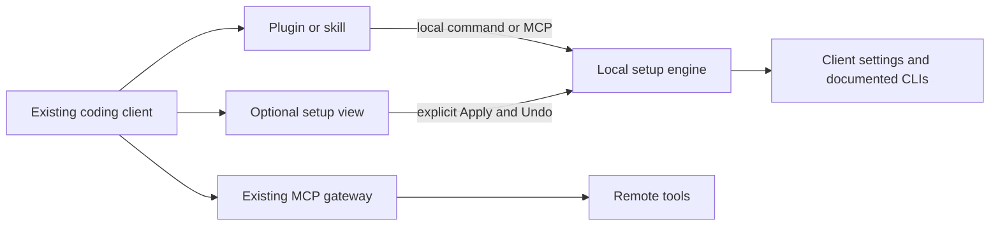

# Distribution and client integration

Reviewed: 2026-10-17. Status: research and proposals, not an implementation decision.

## Owner constraints

Confirmed in this conversation:

- Make existing coding clients easier to use: Codex, Cursor, Claude Code, and others.
- Access the operating system where needed for the product's job.
- Avoid another standalone application the developer must keep open and manage.
- Keep installation and everyday use simple.
- Reduce context overhead and repeated setup work.

The approved [brief](../project-brief.md) already specifies local execution, no account,
a local page, reversible changes, and a read-only MCP interface. This note explores delivery
options. It does not approve a new orchestration service or rewrite the existing contracts.

## Proposed product shape

**An on-demand setup companion inside existing coding clients.**

A small local engine reads configuration and prepares safe changes. A thin plugin or skill
exposes it in each supported client. A visual page is available for comparison and explicit
Apply/Undo. The engine does not need its own desktop shell or an always-running OS service.

The engine manages configuration, not agent traffic. The optional view can be a local browser
page or, where tested and supported, an embedded MCP App. A gateway cannot replace local
execution for files on the developer's laptop.

## Separate three decisions

| Decision | Options | Proposal |
| --- | --- | --- |
| Delivery | Package manager, Git-backed plugin catalog, public marketplace, installer | A reliable direct install plus thin client packages |
| Execution | Client-launched local command/MCP process, permanent service, remote server | Local command or child process; no login-time service by default |
| Interface | Chat response, editor panel, embedded MCP App, browser tab, desktop window | Short chat response for diagnosis; visual view for changes |

“Marketplace” is a delivery channel. It does not itself provide filesystem permissions,
a runtime, or a portable graphical interface.

## Alternatives

| Option | OS access | Daily experience | Tradeoff | Assessment |
| --- | --- | --- | --- | --- |
| Skill + local CLI | Through a local process, subject to host and OS permissions | Ask the agent to inspect setup; command returns a short report | Shell approval and runtime discovery vary; the skill must call deterministic code, not ask the model to edit arbitrary config | Good lightweight entry point |
| Plugin + local MCP | Through the plugin's local server | Tools available from the existing client | Client may keep MCP alive for the session; plugin formats and installation differ | Preferred integrated delivery, with clean-install verification |
| MCP App + local MCP | Through the server, not the embedded iframe | Interactive setup card inside a supporting client | UI support is not universal; needs a text/local-page fallback | Strong later enhancement |
| CLI + local web page | Through the local backend | One command opens a page only when needed | Requires a runtime or packaged executable; process lifecycle must be clear | Most predictable first release foundation |
| IDE extension | Through a local extension host | Sidebar or command palette | Does not cover standalone Codex or Claude Code; remote extension hosts may inspect the wrong machine | Optional later adapter |
| Desktop app | Through its backend and granted permissions | Separate app/window and update lifecycle | More packaging and maintenance; conflicts with the owner's preferred experience | Not recommended for the first release |
| Hosted website/PWA | Limited browser APIs; a helper is needed for the full workflow | Web dashboard plus local connection | Adds account/network/helper concerns without removing local installation | Poor fit for this local product |

Browser file APIs can expose user-selected files, with permission and browser restrictions.
They do not provide the general local process execution needed for vendor CLI operations.
Thus a pure website cannot implement the complete proposed workflow on its own.
[MDN File System API](https://developer.mozilla.org/en-US/docs/Web/API/File_System_API).

## Current platform evidence

These are documented capabilities, not successful installation tests of our package.

| Surface | Verified documentation | Consequence |
| --- | --- | --- |
| Claude Code | Plugins can bundle skills and MCP servers. Local stdio servers are child processes; Claude Code documents their shutdown. Custom marketplaces are supported | A thin plugin can launch local functionality without our own desktop app |
| Cursor | Plugin MCP config supports local commands. Plugin-root variable behavior differs from the portable standard. MCP Apps support is documented | Reuse the engine, but test the Cursor manifest and UI separately |
| Codex/local desktop workflows | OpenAI documents local/Git marketplaces and local MCP packages | Direct/private distribution is a separate path from the public directory; test each target client version |
| OpenAI public directory | Local MCP submissions currently require approved-partner eligibility and allowlisting | Public directory acceptance must not be a release dependency |
| MCP Apps protocol | Hosts advertise UI support; tools can fall back to text. The view is sandboxed | Negotiate support; do not assume all terminals and desktop surfaces render the same UI |
| IDE extensions | VS Code distinguishes local, web, and remote extension hosts | An extension must identify where it is executing; remote workspace access is not laptop access |

Sources:

- [Claude Code plugins](https://code.claude.com/docs/en/plugins)
- [Claude Code MCP](https://code.claude.com/docs/en/mcp)
- [Claude Code marketplaces](https://code.claude.com/docs/en/plugin-marketplaces)
- [Cursor plugin reference](https://prod.cursor.com/docs/reference/plugins)
- [Cursor MCP integrations](https://prod.cursor.com/help/customization/mcp)
- [OpenAI plugin packaging](https://developers.openai.com/plugins/build/plugins)
- [OpenAI desktop-only submission](https://developers.openai.com/plugins/deploy/desktop-only)
- [MCP Apps overview](https://apps.extensions.modelcontextprotocol.io/api/documents/overview.html)
- [VS Code extension hosts](https://code.visualstudio.com/api/advanced-topics/extension-host)

Cloud, SSH, containers, and remote workspaces require an explicit machine boundary. A process
started remotely sees that environment, not automatically the laptop. For the first release,
clearly support local sessions and label other environments as unsupported or separate.

## Installation proposal

### First release foundation

Keep the existing Python engine and browser page. The current manifest requires Python 3.13+;
the [CLI contract](../../specs/001-agent-setup-inventory/contracts/cli.md) already proposes uv.
Use a pinned, published package once a public name is selected. Do not publish or recommend
installing the unrelated `agentsetup` package identified in the naming research.

- Trial: an explicit version via `uvx`, if uv is already installed.
- Regular use: `uv tool install` and a stable executable path in client configuration.
- GUI clients must not depend on an interactive shell's PATH or virtual environment.
- Document first-run downloads and offline behavior. “One command” still has prerequisites.
- Updates are explicit and versioned; client wrappers should use compatible engine versions.
- If real onboarding tests show runtime setup is a barrier, evaluate a signed package with
  its runtime included. This is a packaging experiment, not a proposed language rewrite.

uv documents isolated tool execution, persistent tool installation, upgrades, and interpreter
selection. [uv tools guide](https://docs.astral.sh/uv/guides/tools/).

### Integrated entry point

Offer a small client-specific plugin/skill package over the same engine. Install in one chosen
client first. Detection of other clients is read-only. Connecting additional clients must be
an explicit, previewed setup action. Avoid installing the same skill or MCP twice through
shared directories and client-specific packages.

The launcher should explain missing prerequisites and offer one clear repair action. It must
not silently execute an unpinned installer inside a normal agent conversation.

A plugin should be removable without removing someone else's client configuration. Preserve
backups by default, explain any shared engine left installed, and provide an explicit cleanup
path. Multiple clients may launch separate MCP processes; “one installed engine” does not mean
“one process.” Writes require coordination and a recheck of the file state before Apply.

### Visual view

Use the local page as the portable first option. Open it only on request. Keep a clear Stop
action or bounded idle lifetime; closing a browser tab alone must not be assumed to stop a server.
For an embedded view, first prove MCP Apps support on the specific target client and version.
Reuse the visual components where practical; keep transport and permission handling separate.

The current MCP contract forbids process startup and writes. A new “open panel” tool or
app-only Apply tools would require an explicit contract/spec update before implementation.
A skill invoking the CLI is another entry path to evaluate. No such change is made here.

## OS permissions and trust

The job requires access to known config locations and documented client commands, not general
administrative control of the computer. Use ordinary user permissions; report blocked paths
as unknown. Do not request root, screen recording, or accessibility permissions for inventory.
Host sandbox behavior and filesystem access need tests per installation surface.

Reads and parsing happen locally. Sending a summary back through MCP gives that information to
the coding client and potentially its model provider. That is different from keeping it only
in the local page. Keep summaries redacted, limited, and requested by the user.

Continue the established Apply/backup/verify/Undo model. Local browser endpoints still need
authentication and origin checks. An embedded UI button must invoke a validated change plan;
model-supplied arguments alone must not count as human approval.

## What “less context” can honestly mean

The strongest immediate benefit is less setup work for the developer. Token savings are a
separate hypothesis that needs measurement.

Proposed behavior:

- Compute inventory, precedence, and duplicate findings in code; return only the requested result.
- Keep the full inventory in the visual view. Do not insert it into every conversation.
- Use short skill metadata and narrowly scoped tools. Load explanation details on request.
- Avoid a large global instruction file and automatic startup reports.
- A future profile feature could help select only the plugins needed for a project. This is
  additional scope; it must respect what each client actually allows and require explicit Apply.
- In supporting MCP Apps hosts, UI-only tools can handle pagination or refresh without adding
  those tool definitions to the model's tool list. This does not mean all app data is private
  from the host or that all interactions use zero context.

Native clients already optimize some context: Codex loads full skill instructions when needed,
and Claude Code documents deferred MCP discovery with environment/model exceptions.
[OpenAI skills](https://learn.chatgpt.com/docs/build-skills),
[Claude Code tool search](https://code.claude.com/docs/en/mcp#scale-with-mcp-tool-search),
[MCP Apps tool visibility](https://apps.extensions.modelcontextprotocol.io/api/documents/overview.html#tool-visibility).

One gateway URL does not itself reduce the number of tool schemas exposed to a model.
The application cannot remove already-used conversation tokens or promise immediate reloads
after config changes. Report when reconnecting or starting a new session is required.

Measure on fixed client/model versions and equivalent tasks: initial tool/instruction payload,
diagnostic output size, discovery calls, setup steps, and task success. Where internal context
is unavailable, report observable counts or estimates and label them accordingly.

## Proposed rollout and decision gates

1. Prove direct installation on a clean macOS account: scan, open page, Apply, Undo, stop, uninstall.
2. Prove one thin client package uses that engine without duplicate registration or hidden writes.
3. Add the other client packages with the same checks and explicit local/remote boundaries.
4. Add embedded MCP Apps UI only after a client compatibility test; retain the local page fallback.

Success is a useful result in the existing coding workflow with little setup. Public marketplace
listing, a desktop shell, permanent monitoring, and a cloud account are not prerequisites.

Open decisions: chosen public package name; first plugin host; whether embedded UI is needed
in the first release; and whether project profiles merit a later feature specification.
All are proposals. This note adds no implementation, installs nothing, and changes no client settings.
