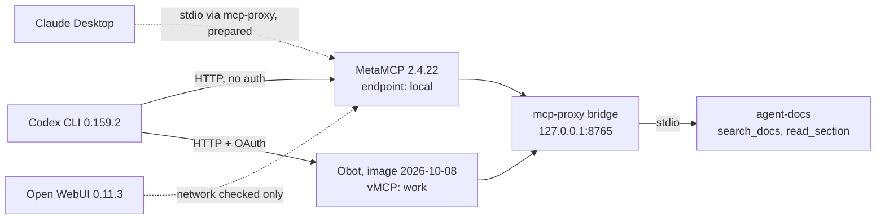

# Gateway trial: MetaMCP and Obot with real clients

Date: **2026-10-16**, [update 2026-10-18](#update-2026-10-18). Status: **research result**, not a decision.
Machine: the owner's Mac (Docker via OrbStack). Everything ran on localhost only.

## Why we ran it

The proposed product ("connect once, manage tools in one web UI") overlaps with existing
open-source gateways. Before writing a specification, we tested two of them with the
owner's real clients and the owner's own MCP server.

## Setup

| Part | Value |
| --- | --- |
| Upstream server | [agent-docs](https://github.com/KonstantinStarovoytov/agent-docs) at commit `6faddf4`, run over stdio and exposed with `mcp-proxy` |
| MetaMCP | `ghcr.io/metatool-ai/metamcp:latest` = v2.4.22, built 2025-12-11. Endpoint auth **off** (local test only). Bound to `127.0.0.1` |
| Obot | `ghcr.io/obot-platform/obot:latest`, built 2026-10-08. Authentication on, local owner account, host Docker socket mounted for the test only. Bound to `127.0.0.1:8880`. Removed after the test |

## Comparison

| Check | MetaMCP | Obot |
| --- | --- | --- |
| Starts with "localhost, auth on, no Docker socket" | Yes | **No**: exits with `failed to initialize Docker backend` |
| First login | Sign-up form | Bootstrap token from logs, then owner account setup |
| Add a remote server | Simple form. **No connection test**: a malformed URL showed "No Error" | Form plus access policy. Tool discovery tests the connection |
| Client authentication | API key, OAuth (beta) or none. Tested: none | MCP OAuth per user. Tested: 401 with resource metadata, then OAuth login |
| Codex | One TOML entry; call passed | `codex mcp add` plus OAuth login; call passed |
| Claude Desktop | stdio bridge prepared and tested outside the app | Not offered in the Connect dialog; not tested |
| Disabled tool hidden in a new session | Pass | Pass |
| Direct call to a disabled tool from an **old** session is blocked | Pass (`Tool has been marked as inactive`) | Not tested (needs our own OAuth client) |
| Tool definition pinning | Not observed | **Yes**: "Managed" mode stores names and descriptions and protects from upstream changes |
| Per-user upstream configuration | Not observed | Configuration values "supplied statically, by users" (seen, not tested) |
| Connect instructions | Endpoint URLs only | Copy-paste for Cursor, VS Code, Claude Code CLI and Codex |
| Credential storage | Postgres; encryption not checked | **Unencrypted by default** (startup warning); needs an encryption provider |
| Release activity | Image ten months old | Image eight days old |
| Paid edition signals | None seen | Many catalog entries marked "Business"; email registration to "unlock all remaining IDPs" |

## Findings

| # | Finding | Type |
| --- | --- | --- |
| 1 | The core demo ("disable in UI, next call is blocked, no client edit") **already works in MetaMCP and Obot**. It is not a differentiator. | Fact |
| 2 | Obot also covers most of the earlier "personal hub" idea: catalog, per-user OAuth, Connect instructions and tool definition pinning. | Fact (pinning and catalog seen; per-user upstream OAuth not tested) |
| 3 | MetaMCP `:latest` is ten months old. README and `example.env` describe bootstrap users and endpoints, but this image ignores them. | Fact |
| 4 | Several MetaMCP UI toggles showed a stale visual state after a click. The real state differed. | Fact |
| 5 | Obot needs control of a container runtime (`OBOT_SERVER_MCPRUNTIME_BACKEND`: `docker` or `kubernetes`) even to proxy a remote server. The Docker setup mounts the host Docker socket, which Obot's docs limit to trusted single-tenant environments. | Fact ([config reference](https://docs.obot.ai/configuration/server-configuration/), [Docker install](https://docs.obot.ai/installation/docker-deployment/)) |
| 6 | Obot's startup cleanup only touches containers labeled `mcp.server.id`. It did not affect the owner's other containers. | Fact (source: `pkg/mcp/docker.go`) |
| 7 | Codex sent a URL as its OAuth `client_id` (Client ID Metadata Document). Obot accepted it. | Fact |
| 8 | The Codex OAuth login waits only a few minutes for the browser callback. Two logins timed out while a person was expected to click. | Fact |
| 9 | `codex mcp add` rewrites the whole `config.toml`: it drops comments, reorders sections and drops ignored or empty keys. Any tool that edits client configs must survive this. | Fact |
| 10 | Codex loads MCP tools lazily. The model could not list tool names without searching, so visibility tests need protocol-level checks. | Fact |
| 11 | Claude Desktop custom connectors go through Anthropic's cloud, so a localhost gateway needs a stdio bridge in `claude_desktop_config.json`. | Fact ([source](https://support.claude.com/en/articles/11175166-get-started-with-custom-connectors-using-remote-mcp)) |
| 12 | agent-docs: `rag-mcp` from its README fails because `pyproject.toml` has no `[build-system]`. `python -m src.service.mcp_server` works. | Fact |
| 13 | The Codex config keeps one MCP credential inline in `http_headers`. Scattered inline secrets are a real pain. | Fact (value not read) |

## Cross-client setup research

Reviewed 2026-10-16 by a research agent from vendor docs, changelogs and source code.
Links: [Claude Code plugins](https://code.claude.com/docs/en/plugins/marketplace-reference),
[Codex plugins](https://learn.chatgpt.com/docs/plugins), [Cursor plugins](https://cursor.com/docs/plugins),
[Agent Skills](https://agentskills.io/specification), [Agent Plugins](https://agent-plugins.org/),
[Obot Sentry](https://github.com/obot-platform/obot-sentry), [mcpm.sh](https://github.com/pathintegral-institute/mcpm.sh),
[MCP Router end of support](https://github.com/mcp-router/mcp-router). Some details are marked unverified in the agent's notes.

| Area | What is already solved | What is still open |
| --- | --- | --- |
| Formats | Agent Skills and AGENTS.md are read by most clients. Codex reads Claude and Cursor plugin and marketplace manifests. Cursor reads Claude skills, hooks and plugins. | Little value in writing format converters |
| One source pushed to all clients | rulesync, ruler, Microsoft APM, Vercel `skills`, ToolHive, Docker MCP Toolkit, mcpm | Crowded |
| One view of what each client actually loads | Obot Sentry (beta, read-only, needs an Obot server), Snyk agent-scan (sends data to Snyk), Runlayer (commercial) | **No local tool that shows MCP + skills + plugins + marketplaces across Claude Code, Claude Desktop, Codex and Cursor, shows duplicates and effective state, and can turn items on or off** |

Local inventory, names not recorded here: the owner's machine has duplicated items across
clients (one plugin in two clients, one MCP server in two clients, one service in three forms),
and Cursor also loads skills from the Claude Code, Codex and shared `.agents` folders.
Much state lives in accounts, not files (Claude connectors, synced skills, some Codex plugins,
Cursor team settings), so a file-only manager would show an incomplete picture.

Main risks: some on/off state is stored in undocumented places; vendors change these
formats often; Obot Sentry and ToolHive are moving into this space.

## What this means for the project (proposal)

- Building another MCP gateway is not justified: MetaMCP covers the simple case, and Obot covers
  the "personal hub" case with OAuth and a catalog, at a higher operating cost.
- The cross-client inventory and control panel is the more original direction. Obot Sentry is the
  closest competitor and has not been tested yet.
- The owner confirmed the main pain later the same day: "I cannot see what is installed and
  enabled where". See the [project brief](../project-brief.md).

## Update 2026-10-18

Checked again from GitHub and the vendors' docs. Not a new runtime test.

**Why MetaMCP runs on the owner's Mac.** It is not a product choice: Kitden connects any MCP
gateway URL. MetaMCP stayed after the trial because it started in the safe local setup (no
Docker socket) and was simple. Obot was removed after the trial.

| Check | MetaMCP | Obot |
| --- | --- | --- |
| Latest release | v2.4.22, 2025-12-19 | v0.26.3, 2026-10-08 |
| Latest commit | 2026-06-22 (README edit) | 2026-10-16 |
| GitHub stars / open issues | 2,712 / 119 | 1,109 / 336 |
| License | MIT | MIT |
| Runtime | App + Postgres containers | `OBOT_SERVER_MCPRUNTIME_BACKEND` is `docker` or `kubernetes`; no mode without a container runtime is documented |
| Credential encryption | Not checked | `OBOT_SERVER_ENCRYPTION_PROVIDER` defaults to `none`; options: aws, gcp, azure, custom |
| Client sign-in | None, API key, or MCP OAuth; OIDC sign-in for the admin UI | MCP OAuth per user through configured identity providers |
| Features listed by the vendor | Namespaces and endpoints, tool on/off, middleware, tool renames and descriptions, rate limits, OpenAPI endpoint, inspector | Gateway, MCP and skills catalog, per-user or per-group access, audit logs, request filters and webhooks, LLM gateway, hosted agents, CLI, Obot Sentry (device features in beta) |

Sources: [MetaMCP repository](https://github.com/metatool-ai/metamcp),
[Obot repository](https://github.com/obot-platform/obot), [Obot docs](https://docs.obot.ai/),
[Obot server configuration](https://docs.obot.ai/configuration/server-configuration/).
Release and commit data from the GitHub API on 2026-10-18.

**What it means (proposal).**

- MetaMCP works for one developer but looks stalled: no release for ten months. Fixes and support
  for newer MCP revisions may not come.
- Obot is active and covers team needs (catalog, per-user sign-in, audit). It costs more to run:
  a container runtime, an encryption provider for credentials, and some features in a paid edition.
- For Kitden the difference is only sign-in: a key reference for MetaMCP, a per-client OAuth login
  for Obot. Both are already supported. Keep MetaMCP for now; plan a short Obot re-test before a
  team version or if MetaMCP falls behind the protocol.

## How to undo the trial

| Item | Undo |
| --- | --- |
| Codex | `obot-work` and its OAuth token are already removed. Remove `[mcp_servers.metamcp-local]`, or restore `~/.codex/config.toml.backup.20261016-mcp-gateway-trial` |
| Claude Desktop | Remove `mcpServers.metamcp-local`, or restore `claude_desktop_config.json.backup.20261016-mcp-gateway-trial` |
| MetaMCP | Remove containers `metamcp`, `metamcp-pg` and their volumes (compose project `metamcp-eval`) |
| Obot | Container already removed. `docker volume rm obot-eval-data` removes its data |
| Bridge | Stop the `mcp-proxy` process on port 8765 |
