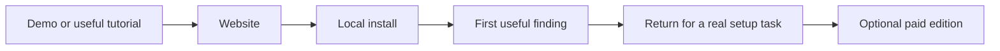

# Kitden launch recommendation

Reviewed: 2026-10-18. Status: synthesis of research; all commercial choices remain proposals.
Seller country: Poland, confirmed by the owner. Legal form is still unknown.

## Recommended route

Launch a local utility with a public website and a sample-data demo. Deliver the tested app
directly, then add client plugin wrappers. Find repeat users before building paid features.
Use hosted checkout when an actual paid offer is ready. No cloud inventory service is needed.

This is a proposed customer journey, not measured conversion or a revenue forecast.

| Need | First choice | Later option |
| --- | --- | --- |
| Public presence | Static website, short video, clearly labeled sample UI | Searchable tutorials and comparison pages grounded in tests |
| Release delivery | GitHub release + Python package via uv for technical beta users | Own Homebrew tap; bundled runtime if installation research justifies it |
| Familiar entry point | One thin client integration over the same local engine | More client catalogs and embedded UI after compatibility tests |
| Discovery | Small group of multi-client developers, then a usable Show HN | Product Hunt after onboarding improves |
| Payments | Lemon Squeezy, subject to seller/product approval | Polar if the first provider is unsuitable |
| Paid offer | Test concrete local value; no mandatory Kitden account | Team features only after specific demand |

Sources and limitations: [release channels](release-channels-2026-10-18.md),
[go-to-market](go-to-market-2026-10-18.md),
[commercial comparison](commercial-options-2026-10-18.md),
[skills and helpers](launch-skills-2026-10-18.md).

## What to sell first

The first marketing promise should be understandable without MCP terminology:

**See what your coding agents load. Change it with confidence.**

Start with macOS developers who use at least two supported clients and have a real setup
problem. Demonstrate one project, an unexpected item, its source and scope, and a supported
change with preview and Undo. Keep supported and unknown state visible.

Close alternatives already exist: [Cross-Code Organizer](https://github.com/mcpware/cross-code-organizer)
and [AgentShelf](https://github.com/yigitkonur/agentshelf). Their current READMEs overlap the
brief more than the earlier comparison indicates. The unique-value hypothesis is better
explanation, reliable actions, and usable design; this is not established superiority.
No percentage of context savings is substantiated.

## Release gates

1. **Before distributing:** settle distribution terms and ownership of release/package names.
   A free beta does not have to be open source, but it still needs clear permission to use it.
   Inspect dependency and asset licenses before adopting terms for the whole package.
2. **Before inviting the first five:** test a built artifact on a fresh account, outside the
   checkout: install, scan, UI, supported change, Undo, stop, update, and uninstall.
3. **Before wider launch:** observe five real setups, then another five to ten independent
   installations. Resolve the largest onboarding and accuracy failures. These sample sizes
   are proposed learning targets, not industry benchmarks.
4. **Before monetization:** identify repeated value and show a specific offer. Profiles,
   historical comparisons, and setup bundles are possible later features, not promises of the
   current release. Do not charge extra to recover from a change Kitden made.
5. **Before a public source release:** decide whether the business is fully open software or
   includes exclusive paid code. Do not assume a future license change can revoke existing grants.

A useful beta measure is whether people return when a new plugin or project creates a setup
question. Daily active use is not automatically appropriate for an occasional utility.
Use consented observation or opt-in measurement; no raw configuration upload is required.

## Store and directory reality

- Own delivery is the foundation. A store listing does not provide demand or necessarily payment.
- Claude Code custom marketplaces are a direct distribution route. Public directories have
  their own review requirements.
- [Cursor requires open-source marketplace plugins](https://prod.cursor.com/help/security-and-privacy/marketplace-security),
  ships no plugin binaries, and reviews updates. Acceptance of an open wrapper with a separate
  proprietary engine remains unverified.
- [OpenAI local MCP public submission](https://developers.openai.com/plugins/deploy/desktop-only)
  requires partner allowlisting. Custom/local catalogs are a different channel.
- Mac App Store sandbox/bundle requirements are a poor first fit for cross-client configuration
  access. Defer it; do not interpret that as proof that approval is impossible.
- MCP Registry is discovery metadata, not hosting or checkout.

## Commercial direction

Two reasonable strategies remain:

| Priority | Proposed license approach | Consequence |
| --- | --- | --- |
| Adoption and an openly maintained tool | Apache-2.0 for the app | Can sell builds/support, but others can redistribute and create closed derivatives |
| Open foundation plus exclusive paid value | MPL-2.0 core and clearly separate proprietary features | Covered files stay available under MPL on distribution; the boundary needs careful review |

A fully proprietary app with a free edition is also viable for direct sales if exclusive code
is the main priority. AGPL dual licensing is not the default recommendation for a local utility.
[Apache](https://www.apache.org/licenses/LICENSE-2.0),
[MPL FAQ](https://www.mozilla.org/en-US/MPL/2.0/FAQ/).

For a paid experiment, compare $29 early access with $49 regular pricing including 12 months
of updates, with continued use of the last eligible release. These are unvalidated test prices,
not proposed public promises. Define support and compatibility separately from the right to
keep using a version. Avoid a lifetime-update promise.

[Lemon Squeezy](https://docs.lemonsqueezy.com/help/licensing/generating-license-keys) can issue
keys and deliver downloads; [Poland is supported for bank payouts](https://docs.lemonsqueezy.com/help/getting-started/supported-countries).
Approval still depends on the actual seller and product. Current base fees are 5% + $0.50,
with transaction and payout extras; see the [fee schedule](https://docs.lemonsqueezy.com/help/getting-started/fees).
This recommendation is based on documentation, not a tested checkout.

A merchant of record handles the covered customer sales-tax workflow. It does not settle the
owner's Polish business registration, income tax, or accounting. Confirm the legal form and
local treatment with an accountant before collecting payment. Have counsel review material
license or acquisition terms; no legal/tax audit was performed.

## Use a small set of helpers

The reviewed community [Marketing Skills](https://github.com/coreyhaines31/marketingskills)
project provides four relevant current skills: `product-marketing`, `copywriting`, `launch`,
and `pricing`. Use only those when the respective job is needed. Their install counts, source
review, current names, and optional install command are in the [shortlist](launch-skills-2026-10-18.md).

For delivery, use uv, PyPI Trusted Publishing, and Homebrew packaging documentation.
For a Cursor wrapper, inspect the official Create Plugin helper. For a later offline paid
edition, Keygen's licensing documentation is a reference, not an extra service required now.

## Concrete next deliverable

A release candidate with one tested installation route, a 60-second demonstration, a small
website with demo data, and a five-user observation plan. Pricing, license adoption, public
posting, provider signup and deployment require their own concrete decisions/actions.
This research does not publish, install, charge, contact users, or alter application code.
