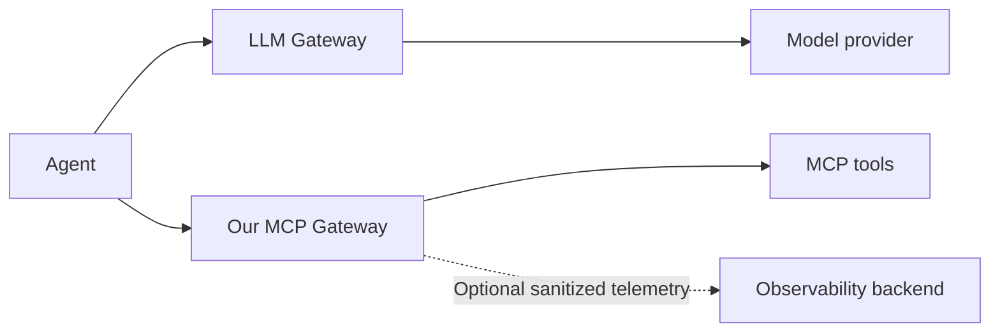

# MCP Gateway research

Reviewed: **2026-10-16**. Audience: one owner and a small team, self-hosted.

## Recommendation

Start with a comparison of **ContextForge** and **agentgateway** using the same small workload.
ContextForge is the first candidate for adopting a management platform; agentgateway is the
first candidate for placing a custom management application around an existing proxy.
This ranking is our fit assessment, not a measured performance or security ranking.

Writing the protocol proxy from scratch is a fallback if neither can meet the required behavior.
The useful product work is clear tool access, credential ownership, understandable policy
decisions, and simple operation for a small team.

## Evidence rules

- This is a review of primary documentation and repositories, not a runtime evaluation.
- A documented capability is not a verified security guarantee. Missing evidence means unknown.
- Sources using `latest` or `main` can change. Pin releases and retain their configuration
  before testing or making an adoption decision.
- No throughput, latency, operating cost, or license compatibility was independently measured.
  Check the license and maintenance status of the exact release before reusing code.
- Standards take priority over vendor examples. Research papers are background, not protocol rules.

## Existing solutions

| Solution | Documented capabilities | What we can learn or reuse | Fit and open checks |
| --- | --- | --- | --- |
| [IBM ContextForge](https://github.com/IBM/mcp-context-forge) | Gateway and registry; admin interface; virtual endpoints; RBAC; telemetry; container deployment | Server inventory, management workflows, and an existing application to evaluate | **Shortlist: complete platform.** Verify per-tool policy, revocation, credential isolation, and protocol versions on a pinned release |
| [agentgateway](https://agentgateway.dev/docs/standalone/latest/) | MCP federation; authentication; authorization; traffic controls; standalone deployment; OpenTelemetry | Reusable request processing and policy enforcement | **Shortlist: gateway engine.** Check management integration, safe configuration changes, and actual client compatibility |
| [Docker MCP Gateway](https://docs.docker.com/ai/mcp-catalog-and-toolkit/mcp-gateway/) | Runs servers in restricted containers; injects credentials; manages lifecycle and profiles; can be installed on Docker Engine | Isolation and lifecycle patterns for local executable servers | Useful when stdio/container servers dominate. Shared-team policy behavior needs evaluation. The open gateway and invite-only Docker AI Governance offering must not be treated as the same feature set |
| [Microsoft MCP Gateway](https://github.com/microsoft/mcp-gateway) | Data/control plane separation; adapter and tool routing; Kubernetes lifecycle management | Architecture boundaries and deployment management | Kubernetes is additional operational work for our first release. Current README requires MCP 2026-07-28 and says legacy initialization and downgrade are unsupported |
| [Kong AI Gateway](https://developer.konghq.com/ai-gateway/entities/ai-mcp-server/) | Current documentation defines MCP servers as managed gateway entities | Policy composition and gateway administration | Evaluate if Kong is already part of the environment. The [older AI MCP Proxy plugin](https://developer.konghq.com/plugins/ai-mcp-proxy/) is explicitly Enterprise-only and points to the newer model; do not mix their configuration or assume free feature parity |
| [AWS AgentCore Gateway](https://docs.aws.amazon.com/bedrock-agentcore/latest/devguide/gateway.html) | Managed tool integration; inbound/outbound authentication; credential handling; discovery | Clear separation of caller identity and upstream access | Architecture reference. The documented managed service does not meet our own-server hosting requirement |
| [LangSmith](https://docs.langchain.com/langsmith/llm-gateway-quickstart) | LLM Gateway setup and tracing integration; a separate MCP interface exposes LangSmith data | Policy events linked to traces; useful operational investigation patterns | Adjacent reference. A general self-hosted MCP aggregation gateway was not established by the reviewed pages |

### LangSmith: three separate roles

LangSmith's [gateway announcement](https://www.langchain.com/blog/introducing-llm-gateway)
describes model-call governance and lists tool/MCP gateways as a future direction on that page.
Its [MCP server documentation](https://docs.langchain.com/langsmith/langsmith-mcp-server)
describes accessing LangSmith traces, datasets, and related data, and points users toward a
remote OAuth-authenticated server. Neither establishes a drop-in gateway for all our MCP servers.
Treat LangSmith as a UX/observability reference and possible optional integration, pending
verification of its current export interface and deployment needs.

## A version trap to resolve early

The official latest MCP specification resolved to **2026-07-28** during this review. Its base
protocol describes stateless requests and per-request capability negotiation.
Do not use older session-based examples as the default architecture without checking the
actual clients. [MCP specification](https://modelcontextprotocol.io/specification/2026-07-28)

agentgateway documents compatibility across the newer and older flows, while Microsoft's
current README explicitly excludes legacy initialization. These are product claims to test,
not a reason to assume our installed clients already support the newer revision.
[agentgateway compatibility](https://agentgateway.dev/docs/standalone/latest/documentation/mcp/spec-compatibility/),
[Microsoft requirements](https://github.com/microsoft/mcp-gateway)

Create a matrix of client version, upstream version, transport, discovery, tool calls,
streaming, cancellation, and authorization. Pin the supported combinations in the first plan.

## Security and reliability practices

The controls below are **proposed project requirements**, derived from the cited guidance.
Exact behavior belongs in the feature specification and tests.

| Risk | Proposed control | Evidence and acceptance example |
| --- | --- | --- |
| Hidden tools remain callable | Filter discovery and authorize every invocation; default deny; explicit deny wins | [agentgateway method-level policy](https://agentgateway.dev/docs/standalone/latest/documentation/mcp/mcp-authz/). Test a direct call to a hidden tool |
| One service accepts another service's token | Validate issuer, audience, expiry, and scopes; obtain separate upstream credentials | [MCP authorization](https://modelcontextprotocol.io/specification/2026-07-28/basic/authorization). Reject a correctly signed token with the wrong audience |
| OAuth proxy acts for the wrong user | Bind consent and credentials to the caller and registered connection; use a maintained OAuth implementation | [OAuth Security BCP](https://www.rfc-editor.org/rfc/rfc9700.html). Never let user A use user B's connection |
| Registration becomes access to internal infrastructure | Validate endpoint and OAuth metadata URLs, DNS resolution, and redirects; use explicit destination allowances | [MCP security guidance](https://modelcontextprotocol.io/docs/2026-07-28/tutorials/security/security_best_practices). Block cloud metadata and undeclared internal destinations; allow named internal MCP services deliberately |
| A server changes a tool after approval | Record metadata/schema fingerprints; require review of material changes; preserve stable names | [OWASP MCP Top 10](https://owasp.org/projects/mcp-top-10). A changed definition does not silently inherit approval |
| Tool output manipulates an agent | Treat text and annotations as untrusted; limit capabilities and output size; do not promise complete prompt-injection detection | [MCP trust principles](https://modelcontextprotocol.io/specification/2026-07-28). A claimed read-only annotation is not sufficient authorization evidence |
| A client keeps old permissions | Recheck the current policy at call admission; scope caches by identity and policy version | Project design proposal. Disable a tool, then call it through an already connected client |
| Slow or excessive calls exhaust the gateway | Apply concurrency caps, deadlines, size limits, and bounded queues; shed excess work | [Google SRE: overload](https://sre.google/sre-book/handling-overload/). A saturated server does not consume every gateway worker |
| Retrying a write duplicates effects | Retry only explicitly safe operations; ambiguous write timeout means outcome unknown | Project design proposal. A timed-out write is not automatically submitted twice |
| Logs expose credentials or private data | Record minimal audit metadata; redact before persistence and export; restrict audit readers | [OWASP MCP Top 10](https://owasp.org/projects/mcp-top-10). Verify logs contain neither bearer tokens nor raw sensitive inputs |
| Local code compromises the host | Put managed executables in restricted runners with resource and network limits | [Docker isolation model](https://docs.docker.com/ai/mcp-catalog-and-toolkit/mcp-gateway/). Do not give the gateway unrestricted host execution by default |
| Clients bypass the central policy | Restrict backend ingress where possible; retain backend credentials at the gateway | Project boundary requirement. Direct upstream access must not offer an alternate path with the same privileges |

Authentication answers **who is calling**. Authorization answers **what this caller may do**.
Both are necessary. Network restrictions and upstream permissions remain part of the system.

## Build or reuse

| Approach | Advantage | Cost or uncertainty | Decision rule |
| --- | --- | --- | --- |
| Adopt ContextForge | Starts with management features | Existing concepts may not fit the intended UX | Prefer if the core scenarios work with configuration or small supported extensions |
| Build management around agentgateway | Own the product experience while reusing a proxy | Must build durable configuration, users, policy editing, and audit views | Prefer if policy/transport behavior fits and management APIs are workable |
| Build a custom gateway on an MCP SDK | Maximum behavior control | Own compatibility, security boundaries, streaming, and operations | Choose only for documented gaps or an explicit learning/product goal |

### Small experiment before choosing

Use two synthetic MCP servers with duplicate tool names, two identities, one allowed tool,
one denied tool, and a deliberately slow endpoint. Run both candidates on the same machine.

| Gate | Evidence to record |
| --- | --- |
| Compatibility | Exact client/server/engine versions and supported message flows |
| Enforcement | Discovery filtering, direct-call denial, immediate admission-time revocation |
| Identity isolation | Separate caller and upstream credentials; no cross-user reuse |
| Resilience | Timeout and overload results; no duplicate writes; bounded memory |
| Operations | Time to configure, restart, restore, rotate a credential, and diagnose a denial |
| Measurement | Added latency separated from upstream execution time; CPU and memory under stated load |

Keep failed gates visible. No candidate has passed these checks yet.

## Architecture and design references

| Need | Primary reference | How we will use it |
| --- | --- | --- |
| System diagrams | [C4 model, Simon Brown](https://c4model.com/) | Context and container views first; add a request sequence for policy decisions |
| Architecture document structure | [arc42 overview](https://arc42.org/overview/) | A short tailored structure: goals, constraints, boundaries, runtime, decisions, risks |
| Record why a choice was made | [Architectural Decision Records](https://adr.github.io/) | One brief record per consequential choice, with alternatives and tradeoffs |
| Real gateway architecture | [ContextForge architecture](https://ibm.github.io/mcp-context-forge/latest/architecture/) | Study its design records and security boundaries; verify examples against the MCP standard |
| Management interface patterns | [Carbon data tables](https://carbondesignsystem.com/components/data-table/usage/) | Searchable server/tool lists, expandable details, visible status, and scoped actions |

Recommendation: use C4 + a small arc42-style document + decision records for architecture.
Use Carbon as an interaction reference for the admin interface. This does not select a UI
library or authorize copying branding. The [architecture proposal](../architecture/overview.md)
contains an original screen map and request flow.

## Reading order

1. **Protocol:** [MCP 2026-07-28](https://modelcontextprotocol.io/specification/2026-07-28), then
   [authorization](https://modelcontextprotocol.io/specification/2026-07-28/basic/authorization).
   These define interoperability requirements.
2. **Security:** [MCP security guidance](https://modelcontextprotocol.io/docs/2026-07-28/tutorials/security/security_best_practices)
   and [RFC 9700](https://www.rfc-editor.org/rfc/rfc9700.html).
   These ground the credential and trust-boundary design.
3. **Threat coverage:** [OWASP MCP Top 10](https://owasp.org/projects/mcp-top-10).
   Its page currently labels the project as beta; use it as a threat checklist, not certification.
4. **Operations:** [Google SRE, Handling Overload](https://sre.google/sre-book/handling-overload/).
   Apply its overload lessons to bounded tool execution.
5. **Research background:** Ivo Brett, [Simplified and Secure MCP Gateways for Enterprise AI Integration](https://arxiv.org/abs/2504.19997),
   2025-04-28. The abstract describes a self-hosted gateway reference architecture and threat mapping.
6. **Research background:** Herman Errico, Jiquan Ngiam, and Shanita Sojan,
   [Securing the Model Context Protocol: Risks, Controls, and Governance](https://arxiv.org/abs/2511.20920),
   2025-11-25. The abstract frames content injection, compromised dependencies, and overreaching agents.

The two papers were screened at abstract level, not fully reviewed. They are arXiv preprints;
no peer-review status was established. Both predate the latest MCP revision reviewed here.

## Limits of this research

No product was installed, benchmarked, penetration-tested, or connected to private team data.
The shortlist is sufficient for a first specification and a focused comparison, not a production
security endorsement. The actual MCP servers and AI clients are the most important missing inputs.
