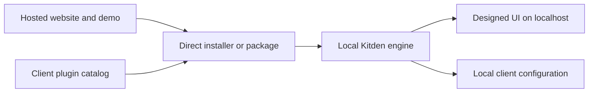

# Kitden release channels

Reviewed: 2026-10-18. Status: research and proposals, not a release approval.

## Product fit

Confirmed scope: Kitden runs on the developer's computer, opens a local web page, and
reads or safely changes coding-client configuration. Local use needs no account. The
owner wants the designed UI to be visible without maintaining another desktop app.
The approved name is Kitden. The local manifest currently declares Python 3.13+ and
version 0.2.0; this is not evidence that a package has been publicly published.

**Proposal:** host the website, documentation, demo and downloads. Keep the working
engine and real configuration data local. Use direct installation as the foundation;
client plugins are optional entry points and discovery channels.

The hosted demo uses fictional data. Hosting the application backend remotely would
not by itself give it access to a customer's laptop. A remote helper connection is
additional infrastructure, not needed for the first release.

## Channel comparison

| Channel | Verified capability | Proposed role | Main constraint |
| --- | --- | --- | --- |
| GitHub Releases | Versioned release notes and downloadable assets [1] | Canonical release page, changelog, checksums and issue link | A source archive alone is poor onboarding; attach ready-to-use artifacts |
| PyPI + uv | uv runs tools in isolated environments, installs stable commands and selects a Python version [2] | First beta route for developers already using uv | uv is a prerequisite; test runtime download, first-run delay and GUI-client PATH |
| Own Homebrew tap | Anyone can maintain a tap; direct install can add it automatically [3] | Recommended macOS convenience route after beta | Requires Homebrew, maintenance and package trust; does not mean homebrew/core acceptance |
| Claude Code marketplace | A Git-hosted custom marketplace can distribute plugins directly [5] | First integrated wrapper: one skill and optional local MCP | Client execution permissions still apply; separate official-directory review |
| Cursor Marketplace | Public Git repository submission and manual review [7] | Additional discovery after direct installation works | Marketplace plugin must be open source; security docs say no bundled binaries and updates are reviewed [8] |
| Codex local/Git marketplace | Custom catalogs and CLI marketplace sources are documented [9] | Direct/private wrapper distribution and testing | Test actual desktop and CLI versions; custom catalog is not the public directory |
| OpenAI public directory | Local MCP submission requires approved-partner allowlisting [10] | Later opportunity | Acceptance is unavailable by default; cannot be a launch dependency |
| MCP Registry | Public metadata for local packages or remote services; supports open and closed source [11] | Discoverability for the read-only MCP interface | Not hosting, payment or a guarantee of catalog inclusion; namespace/package verification [12] |
| Mac App Store | Requires sandboxing and a self-contained bundle [13] | Defer | Cross-client file access and vendor CLI use need a substantial compatibility experiment |
| Signed direct macOS package | Apple documents notarized distribution outside the store, with optional App Sandbox [14] | Later if users struggle with package managers | Packaging, signing, notarization and updates add work; still need OS permission handling |

Sources in the table describe documented capabilities. No publishing, installation or
store-acceptance test was performed for this research.

## Recommended sequence

### 1. Private or limited beta: a reproducible direct install

Proposal: publish the chosen version to a controlled release channel, then invite a
small set of developers who use at least two target clients. Offer one primary
installation path and a single clear launch action. Use PyPI + uv initially if this
audience already has uv; do not describe it as zero-install.

Validate the packaged artifact on a fresh macOS account: install, show inventory,
open the UI, preview a supported change, Apply, Undo, stop, upgrade and uninstall.
Test outside the source checkout so missing static assets or development dependencies
are caught. Record supported client versions and machine architectures.

The release must not silently register itself in every client or add a login service.
Use a stable executable path for client integration. A pinned release should not
silently switch to the latest code when the agent starts.

PyPI Trusted Publishing can exchange CI identity for short-lived publishing credentials,
avoiding a persistent upload token. GitHub Actions is a supported provider [4]. This is
a release-pipeline proposal, not an existing project capability.

### 2. Public launch: website plus a macOS-friendly route

Proposal: add an own Homebrew tap with declared Python/runtime dependencies. A Python
CLI does not need a language rewrite: Homebrew documents isolated virtual environments
and dependency resources for Python applications [15].

The website should offer the working product, a short visual demo, supported clients,
privacy explanation, release history and one installation CTA. A fictional-data demo
lets people inspect the design before trusting local filesystem access.

Do not build a native window just to qualify for an app store. If evidence shows that
Homebrew/uv setup causes abandonment, test a signed package that includes the runtime
and opens the same browser UI. A packaged launcher need not become a permanent app.

### 3. Reach users through client ecosystems

Proposal: create thin wrappers over the same tested engine, one client at a time.
Claude Code offers a direct custom-marketplace path without waiting for directory
curation; Anthropic separately accepts external-plugin submissions for review [6].

Cursor's submission instructions are public, but acceptance remains curated. Its
open-source requirement applies to the marketplace plugin. It does **not** establish
that every separate commercial service or engine must be open source. Conversely, an
open wrapper does **not** guarantee acceptance of a closed external engine. Confirm
that packaging arrangement with review before making a commercial commitment.

OpenAI distinguishes custom catalogs from the universal public directory. Use direct
catalog distribution and clean-install tests first. Do not mistake documentation for
partner eligibility or promise public listing dates.

The official MCP Registry is useful once the MCP package is stable and public. It
stores discovery metadata pointing to the package; the UI product remains distributed
through its own release channel. Registry documentation still labels the service preview.

### 4. Defer channels that change the product

- Mac App Store: sandbox and bundle rules conflict with the intended frictionless
  multi-client access pattern. This is a feasibility risk, not a finding that approval
  is impossible. Direct signing/notarization is a better experiment first.
- Hosted control-plane SaaS: introduces account, remote-helper and privacy complexity.
  It is not necessary to host a marketing site or sell licenses.
- Docker as the main consumer install: would require mounting host settings and solving
  host CLI access. This would add friction for the local developer use case.
- A separate IDE extension: possible future convenience, but only covers some clients
  and creates another release track. First prove that users prefer an embedded view.

## Shipping helpers worth examining

These are candidates to inspect, not tools installed by this research:

- [uv](https://github.com/astral-sh/uv): tool installation and managed Python selection.
- [PyPI Trusted Publishing](https://docs.pypi.org/trusted-publishers/): CI publishing.
- [Homebrew tooling](https://docs.brew.sh/How-to-Create-and-Maintain-a-Tap): tap creation and lifecycle.
- [Cursor Create Plugin](https://cursor.com/marketplace/cursor/create-plugin): official
  plugin-scaffolding and submission-review skills. Use only after the wrapper is specified.
- OpenAI's plugin packaging guide documents Plugin Creator for local plugin/catalog
  scaffolding [9]. Availability in this user's installation was not verified.

## Unresolved before publishing

1. Actual ownership/availability of the Kitden package and domain names.
2. Chosen license and commercial model; no assumption that marketplace listing provides
   a checkout, subscriptions or entitlement enforcement.
3. Whether beta users already have uv or Homebrew, and which installation path succeeds.
4. Clean-install compatibility, runtime packaging and cross-client duplicate registration.
5. Plugin review eligibility, accepted external-runtime pattern and release lead times.

## Primary sources

All reviewed on 2026-10-18:

1. [GitHub Releases](https://docs.github.com/en/repositories/releasing-projects-on-github/about-releases)
2. [uv tools](https://docs.astral.sh/uv/guides/tools/)
3. [Own Homebrew tap](https://docs.brew.sh/How-to-Create-and-Maintain-a-Tap)
4. [PyPI Trusted Publishing](https://docs.pypi.org/trusted-publishers/)
5. [Claude Code custom marketplaces](https://code.claude.com/docs/en/plugin-marketplaces)
6. [Anthropic official plugin repository and submission process](https://github.com/anthropics/claude-plugins-official)
7. [Cursor plugin reference and submission](https://prod.cursor.com/docs/reference/plugins)
8. [Cursor marketplace security](https://prod.cursor.com/help/security-and-privacy/marketplace-security)
9. [OpenAI plugin packaging and custom catalogs](https://developers.openai.com/plugins/build/plugins)
10. [OpenAI desktop-only submission](https://developers.openai.com/plugins/deploy/desktop-only)
11. [MCP Registry purpose and boundaries](https://modelcontextprotocol.io/registry/about)
12. [MCP Registry publishing requirements](https://github.com/modelcontextprotocol/registry/blob/main/docs/reference/server-json/official-registry-requirements.md)
13. [Apple App Review Guidelines, 2.4.5](https://developer.apple.com/app-store/review/guidelines/)
14. [Apple distribution preparation](https://developer.apple.com/documentation/Xcode/preparing-your-app-for-distribution)
15. [Homebrew Python application packaging](https://docs.brew.sh/Language-Specific-Formulae)
