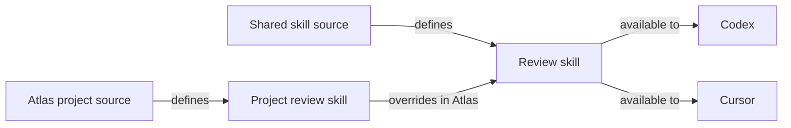
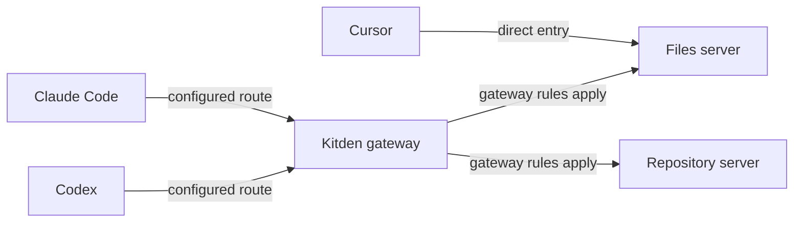

# Kitden: visual setup management

Date: 2026-10-22. Repository baseline inspected: `4c3e6d7`.
Status: detailed UX concept for review and a future prototype. This is not an approved
implementation specification or a claim that the proposed screens exist.

## 1. Purpose

Kitden should help a person understand and manage what their coding agents use without
having to reconstruct the answer from settings files and several separate pages.

The owner described three related needs:

1. See the setup of one agent: plugins, skills, MCP servers, tools and other supported items;
   know where each comes from and whether it applies globally or to a project.
2. Compare several agents working on the same project, understand meaningful differences,
   and add or move supported items with a clear result.
3. Manage tools through a local MCP gateway, including which calls are allowed for a project.

The experience must be simple, pleasant, quick to open and careful with local settings and
secrets. The design must support understanding as well as performing changes.

The intended result is that a person can answer these questions without an explanation from
the developer:

- What is available to this agent in this project?
- Where did it come from, and why is it available here?
- What differs between my agents, and does that difference matter?
- What will change, for which projects and agents, if I press this button?
- Which tool calls does Kitden control, and which connections bypass it?

## 2. Relationship to the current app

The current implementation already has a Library matrix, a project selector, item Details,
a Gateway route diagram, tool switches, strict mode, project additions for supported items,
Add missing, and the preview/Apply/verify/Undo flow. These are a useful base.

The [existing follow-up design](../superpowers/specs/2026-10-21-review-follow-up-design.md)
mainly adds capabilities and improves existing surfaces. The
[roadmap](../../ROADMAP.md) still places a wider setup map in Later.

This concept connects those capabilities into a clear visual model. It does not propose
rebuilding working management operations or adding every possible integration. Current
feature references were checked in the repository, not revalidated in running clients during
this documentation task.

Keep the identity defined in [design.md](../design.md): Quiet Den + Graphite, the existing
brand, system fonts, light and dark themes, compact controls and calm motion. A new visual
identity is outside this concept. The main design work concerns structure, relationships,
scope, state and the path from an observation to an action.

## 3. Three views of the same setup

These are user tasks, not three separate databases or independent configuration systems.

| View | Main question | Main presentation | Main action |
| --- | --- | --- | --- |
| Setup map | Where does this come from, and who uses it? | Grouped sources, items and clients; selected relationships | Inspect a source or resolve a specific setup issue |
| Compare | What differs between my agents? | Items as rows, clients as columns | Add selected missing items or inspect a difference |
| Access | What can agents call through the gateway? | Routes, servers and tools with effective permissions | Change a server or tool rule for a named scope |

Start with a small navigation change in the prototype:

- Overview remains the entry point and gives access to the setup map.
- Library remains the comparison surface.
- Gateway remains the access surface.
- Details and Changes remain shared across them.

The names Map, Compare and Access are working labels for the concept. Test whether they help
before renaming existing pages. Do not add a second navigation system with duplicate pages.

Moving between views preserves the selected project and, where relevant, the selected item.
For example, a server selected on the map opens the same server in Gateway; it does not make
the person search for it again.

## 4. Shared project context and scope

Keep one visible project selector in the app shell. The main choices remain All projects and
a known project. A project is identified by its short name; a path is available in Details
or the selector's disambiguation, not repeated throughout the page.

Define the meanings carefully:

| Term | Meaning |
| --- | --- |
| All projects | The shared baseline. It is not the union of every project's effective state. |
| Global | The source or rule applies across projects unless a supported project rule changes it. |
| This project | The effective setup for the selected project, including inherited items. |
| From global | The project receives this item or permission from the shared baseline. |
| Project override | A project rule changes the result it would otherwise inherit. |
| From a parent project | A known containing project provides the inherited rule, where supported. |

All projects must not show a single On state as if every project has that state. If exceptions
are known, show a quiet link such as `2 project exceptions` that opens their explanation.
Changing a global default does not silently remove project overrides.

In a selected project, use one short origin label when it changes the user's decision:
`From global`, `In this project`, or `Project override`. Details explains the full chain.
Do not attach every possible badge to every row.

Browsing context is not permission to write into that context. Each action still names its
actual target before Apply:

- Prefer Add to this project when that item and client support it.
- Offer Add for all projects as an explicit choice when available.
- If only a global action exists, label it as global before the review opens.
- If changing a shared source also affects another client, name that client in the review.
- A project selector on the page does not prove that a running agent session was identified
  as that project. The Access view must keep those two facts distinct.

## 5. Setup map: explain sources and relationships

### 5.1 First view

Use a stable, grouped layout. Show source groups, item groups and the clients found on the
computer. The first view should fit the normal desktop viewport without requiring the user
to pan around a large canvas.

Show names, client icons and useful counts. Keep paths, commands, URLs and raw settings in
Details. Group many skills or tools instead of drawing every one immediately.

The map supports two levels:

1. Overview: which groups of items reach which clients in the selected context.
2. Selected item: the specific source, inheritance and affected clients for that item.

Search can go directly to the second level. The user should not need to expand five groups
to find an item whose name they already know.

### 5.2 Relationship meanings

An edge must have one clear meaning. Supported examples include `defines`, `contains`,
`available to`, `overrides`, and `routes through`. Direction follows that meaning, not an
attempt to make every relationship point toward the gateway.

Do not suggest that skills or instruction files travel through the MCP gateway. Installation
origins and MCP call routes are different relationships. The setup map focuses on origins;
the Access view focuses on routes.

Illustrative fixture, not a claim about any client's file discovery rules:



This explains a useful distinction: two clients can use one shared installation. That is
different from two separate copies, and neither alone proves that one session loads a
duplicate. Show an actual duplicate warning only when supported by the setup analysis.

### 5.3 Selection and actions

Selecting a client highlights its related sources and items. Selecting an item highlights
where it comes from and all clients affected by it. Other relationships become quieter but
remain readable. Keyboard focus can select the same nodes as a pointer.

A selected item opens the shared Details panel with:

- Its name and type.
- Its effective state in the selected context.
- A short explanation of the source and inheritance.
- The affected clients.
- The next supported action, with secondary actions below it.
- Technical evidence under Details within the panel.

Useful action links include `Compare across clients`, `Manage tools`, and `Review duplicate`.
Each link preserves context. Any mutation goes through the existing review flow.

The map is not an editor for configuration connections. Dragging a node or wire must not
move an installation, grant access, or change a file. Drag-to-connect and arbitrary node
placement are outside the first prototype.

### 5.4 Handling larger setups

Expand one selected group or item at a time. Collapse unrelated groups; preserve the layout
when Details opens. Keep a text/list path to the same answer for users who do not use the map.

Use a deterministic layout rather than a graph that constantly rearranges itself. Avoid
crossing all possible edges at once. If a large fixture becomes hard to read, show fewer
relationships and offer a focused view before introducing zoom and pan controls.

Counts describe discovered entities in the current view. They do not estimate model context
tokens, prove runtime use, or imply every tool was called. Unknown counts stay unknown.

## 6. Compare: make differences actionable

Keep the current item-by-client matrix. It is the main working surface for comparing many
items. The map explains relationships; the matrix supports scanning and choosing changes.

### 6.1 Layout

Keep the project selector in the shell. Within Library, use the existing type tabs, search
and client columns. Provide a differences filter and the existing Add missing entry point.
Avoid adding a separate dashboard of summary cards above the useful rows.

Conceptual layout; labels are proposals, not final UI copy:

```text
Project: Atlas                                      Search setup...

Skills     Plugins     MCP servers     Other supported types
All items / Differences                              Add missing...

Item                    Claude Code       Codex          Cursor
Review skill            Available         Available      Available
                        In project        From global    Shared source
Test helper             Available         + Add          + Add
Repository server       Available         Needs review   Available
```

### 6.2 State vocabulary

Keep three questions separate: does the item exist, is it effective here, and can Kitden
perform the requested action?

| State | Meaning | Interaction |
| --- | --- | --- |
| Available | Saved settings make the item available in this context | Open Details |
| Off | It is present but disabled by a known rule | Explain the deciding rule; offer a supported change |
| Missing | It is not found in this client after a successful read | Add if compatible, otherwise explain the limit |
| Unknown | The relevant source was not read or could not be interpreted | Retry or inspect; do not treat it as missing |
| Needs review | Similar entries differ or cannot be safely matched | Compare the known differences |

An unavailable operation is a capability limit, not an error state for the item. Use a short
reason such as `Manage in Cursor` where appropriate. Do not show an Add button that can only
fail after it is pressed.

The prototype may test Available against the current Loads wording. Keep the saved-settings
qualification either way; neither word should suggest that Kitden observes live context.

### 6.3 Matching and alignment

Use source identity and supported configuration evidence when available. Equal names alone
are insufficient to declare equal content, versions, destinations or permissions. Unknown
equivalence must not become an automatic overwrite or a “fully aligned” badge.

Add missing opens a single review grouped by client. Every candidate names the item, target
scope and reason it is missing. A clearly stated selection can be prefilled, but uncertain
matches, destructive replacements and unsupported conversions must not be included silently.

Separate the following outcomes in the review:

- Selected additions that Kitden can perform.
- Items already available through inheritance or another source.
- Different items that need a person's decision.
- Unsupported operations with a short explanation.

Do not propose installing another copy when a supported shared source already provides the
item. After verification, update the affected cells and keep the user at the same rows.
Undo remains available through the shared Changes flow.

## 7. Access: understand and change gateway permissions

### 7.1 Route summary

Show the gateway's connected clients and held servers. Keep direct client-to-server entries
visible as a separate route when they are known. This distinction explains which calls a
gateway rule can affect.

Illustrative setup:



Use the label `Direct` for the last route, with `Move into gateway...` when supported.
Direct does not automatically mean dangerous or misconfigured. It means those calls are
outside the gateway's rules. A connection line represents saved routing configuration unless
the app has stronger evidence; it must not animate as if it were live traffic.

### 7.2 Server and tool layout

A server row shows its name, effective state and relevant clients. Open it to manage tools.
Keep token handling, transport details and addresses behind Details.

Conceptual tool panel:

```text
Files server                                    Project: Atlas
Through Kitden                                  2 clients

Whole server                                    Allowed
New tools                                       Blocked until reviewed

Tool                    Permission              Origin
Read file               Allowed                 From global
Edit file               Blocked                 Project override
Delete file             Blocked                 From global
Export file             New · blocked            No explicit permission

Review write access...                          Details
```

The permission state and a tool's reported behavior are separate facts. `Allowed` means the
gateway policy permits a call. A label such as `Read (reported)` describes the server's claim;
`May write` can describe a name-based estimate. `Unknown` is a valid behavior label.

Do not use green permission states as proof that a tool is harmless. A permitted tool can
have side effects, and a broad tool may act differently depending on its arguments.

### 7.3 Batch actions and strict mode

Provide a convenient action for reviewing tools that may change data. A working label is
`Review write access...`. The resulting review names the suggested tools and explains the
basis of the suggestion. It also makes unclassified tools visible, so the user does not
mistake a partial selection for a guarantee that everything else only reads.

Keep strict mode's actual behavior explicit:

- New tools without permission remain blocked in strict mode.
- Enabling strict mode must show which existing permissions it preserves or changes.
- Do not imply that all existing tools were individually approved if the mode preserves a
  previously enabled set.
- A tool switched off is refused on subsequent checks through the gateway; an already
  running call is outside that promise.
- Changes to what a client displays may require a fresh tool list or session. Do not confuse
  that display delay with whether a later call is allowed.

A credential restricted by the upstream service can add another control. The UI must not
claim to inspect that restriction unless it actually has evidence.

### 7.4 Project exceptions and unknown sessions

Show the current effective permission first, then its origin. `Use inherited setting`
removes the selected project's override; its preview states what permission will result.
When a parent project's rule applies, name that parent rather than incorrectly saying global.

The current design uses global rules when a session's project cannot be identified. Preserve
and explain this boundary. A selected project in the UI must not produce a claim that all
open clients are currently using that project's restrictions.

## 8. One Details panel and one change flow

Use a shared Details model across the three views. The panel should answer, in this order:

1. What is this item, and what is its effective state here?
2. Why does it have this state, and where does it come from?
3. Which clients and projects can this action affect?
4. What can I do next?
5. What technical evidence supports the explanation?

Details can expose paths, source files, rule precedence and configuration differences.
Secrets remain hidden; revealing technical details must never reveal a raw token.

All mutations keep the existing sequence:

`Choose action → Preview → Apply with backup → Verify → Updated view → Undo`

The preview leads with the outcome, target scope and affected clients. Raw file changes are
secondary. For example: `Add Test helper to Codex in Atlas. Other projects are unchanged.`
Only use that last sentence when the actual change guarantees it.

A pending switch must not look applied. Cancel returns to the same item and focus position.
After verification, update all affected views from the same result. A failed or partly
recovered change shows the real remaining state and the available next action.

Undo copy must reflect the operation's actual limits. For example, reinstalling a removed
plugin may not restore its saved options. Do not replace that known limit with an unconditional
“Everything can be restored” promise.

## 9. States the prototype must include

| Situation | Required response |
| --- | --- |
| No clients found | Explain what can be detected and provide a useful next step |
| One client found | Focus on its sources and project scope; comparison must still be useful |
| No project selected | Show the shared baseline, with project exceptions clearly separate |
| Partial scan | Show readable data; identify the source still loading |
| Source failed | Preserve last known data as stale; do not turn its items into Missing |
| New strict-mode tool | Show it as new and blocked until permission is reviewed |
| Direct and gateway routes coexist | Show both routes and the limit of gateway control |
| Same name, different source | Keep the distinction and provide a comparison |
| Apply pending or failed | Preserve the real state, progress and recovery context |
| Settings changed since preview | Refresh the preview before applying a now different change |
| Project removed or unavailable | Explain it; do not silently retarget an action to global scope |

Use local loading and error states where possible. One unavailable client should not make
the entire interface unusable. Suppress a change only when its required evidence is missing.

## 10. Visual, interaction and performance rules

Follow the current design system. The main screen carries names, clients, states needed for
the decision and actions. Technical details stay in Details. Avoid large explanatory blocks
where the structure can carry the meaning.

- Use consistent shapes and labels for clients, items and sources across views.
- Use color with text or shape; never make color the only state signal.
- Keep the project context visible while editing a permission or reviewing a change.
- Keep the list/table route fully usable without the diagram.
- Make selection, expansion and Details keyboard-accessible, with visible focus.
- On a narrow window, stack source → item → client and open Details as a focused panel.
  Do not shrink a full map until its labels become unreadable.
- Animate verified changes and selection cues only. No decorative traffic pulses or moving
  nodes while the app is idle. Respect reduced motion.
- Opening or expanding the map uses existing inventory data; it must not start a server,
  authenticate to a service or run every client's version command.
- Keep slow discovery in the background and show its status. Build only visible diagram
  detail; do not render every tool of every server at startup.

Measure time to the first usable view and to complete data separately. Compare the prototype's
implemented version with the current app on the same fixtures and hardware before claiming
a speed improvement. Cached configuration is useful only when its freshness is clear.

## 11. Information needed from the existing model

Use the current inventory and change engine as the starting point. The UI needs these facts,
whether they already exist or require a small view-model addition:

| Fact | Why the UI needs it |
| --- | --- |
| Stable item and source identity | Keep selection and compare the same object across views |
| Item kind and containing bundle, if known | Explain plugin contents and shared skills |
| Storage scope and effective scope | Separate where it is installed from where it applies |
| Source relationship and deciding rule | Explain inheritance and overrides |
| Known affected clients | Preview shared-source effects honestly |
| Match evidence and unresolved differences | Avoid equating entries by name alone |
| Direct or gateway route | State where access rules apply |
| Effective permission and origin | Separate policy result from tool behavior labels |
| Read status and freshness | Distinguish Missing, Unknown and stale results |
| Supported action and its scope | Show useful actions without promising unsupported writes |

Do not add runtime telemetry just to make the map look active. Where evidence is missing,
display uncertainty. Concrete claims about client formats or discovery rules must be checked
against that client's current documentation during implementation, with the check date.

## 12. Prototype scope and evaluation

Build one connected prototype with synthetic data. It must not edit the real home folder,
start real MCP servers, or use real credentials. Reuse the current visual language so the
evaluation tests understanding rather than a new brand.

Include these connected scenes:

1. Overview and grouped setup map for three clients.
2. A selected skill showing one shared source and multiple clients.
3. The same setup in a project with an override.
4. A comparison with a missing item and a same-name item from a different source.
5. An Add missing review with explicit target scopes and affected clients.
6. Gateway access with a direct route, inherited tool permissions and a new blocked tool.
7. A verified change followed by Undo, plus a partial-read or failed-change state.

Use three fixture sizes: one client and a few items; three clients with dozens of items and
several projects; and a stress fixture with hundreds of items and long names. These are test
inputs, not claims about the typical user. Include an unknown tool behavior and an unreadable
source in the ordinary fixture, not only in an error demo.

Test with the owner and a small number of intended users. Ask them to do the following without
explaining the interface first:

| Task | Evidence of success |
| --- | --- |
| Explain why two clients have a skill | They identify the shared source and do not assume two copies |
| Find what differs in Atlas | They locate a real difference and distinguish it from inheritance |
| Add the missing item only to Atlas | They identify the actual scope before Apply |
| Inspect two same-name items | They notice the source difference and do not assume equivalence |
| Block a gateway tool for Atlas | They understand the project override and later-call effect |
| Explain the remaining direct route | They understand that its calls are outside gateway rules |
| Undo the change | They find Undo and understand what it restores |

Record completion, wrong turns, time to the first correct explanation, and any mistaken belief
about scope or protection. Compare the key tasks with the current interface. A small test is
directional evidence, not proof that the design works for everyone.

Keep the map only if it improves source and relationship tasks. The comparison matrix remains
valuable even if the diagram needs simplification. Scope and access misunderstandings require
a design correction before implementation is treated as ready.

## 13. Suggested delivery boundaries

1. Prototype the shared context, selected-item explanation and three connected task views.
2. Test the key tasks and settle the layout, labels and action placement.
3. Implement the shared scope and Details improvements using existing operations.
4. Add the focused map using the same data, then connect comparison and access transitions.
5. Check larger datasets, keyboard operation, both themes and startup behavior.

This sequence is a recommendation for the UX work, not a replacement for the currently
approved engineering plan. Small improvements can ship independently. Do not delay an
existing functional fix solely to wait for the entire concept.

Outside this first concept: a free-form graph editor, drag-to-install, automatic synchronization,
live context inspection, context-token estimates, process sandboxing, cloud accounts, team
policies, a new design system and new client support. Instruction files can join these views
when inventory support exists; a prototype must label such data as illustrative.

## 14. Handoff and completion criteria

The next design deliverable should contain a clickable prototype, the fixtures used, a short
record of task results, and the resolved decisions needed for implementation. It should reuse
this document rather than repeat the earlier product reviews.

The following choices remain hypotheses to test: whether the map belongs directly on Overview
or behind a Map control; whether Map/Compare/Access are better navigation labels; how much
origin information fits in a matrix cell; and whether the write-access action is understood
without overstating protection. These do not block recording the concept.

The concept is ready for implementation planning when:

- The three views tell a consistent story about the same selected project and item.
- A user can trace an item's source and identify the affected clients.
- A user can predict an action's scope before Apply.
- Differences, shared sources and genuine duplicates are visibly distinct.
- Gateway permissions and direct routes are understandable without a security lecture.
- Unknown or stale information never appears as a confirmed absence or permission guarantee.
- Every proposed change has a supported operation, a truthful preview and an honest Undo.
- The design stays usable on the larger fixture and without the map.

## References

- [Owner's vision and initial review](product-review-2026-10-21.md).
- [Comparison of review verdicts](review-verdicts-response-2026-10-21.md).
- [Current design system](../design.md).
- [Existing follow-up design](../superpowers/specs/2026-10-21-review-follow-up-design.md).
- [Roadmap](../../ROADMAP.md).
- [Library UI](../../src/kitden/web/static/js/library.js) and
  [comparison model](../../src/kitden/views/load_map.py).
- [Gateway UI](../../src/kitden/web/static/js/gateway.js) and
  [tool view model](../../src/kitden/local_gateway/views.py).
- [Shared panels and reviews](../../src/kitden/web/static/js/panel.js).
