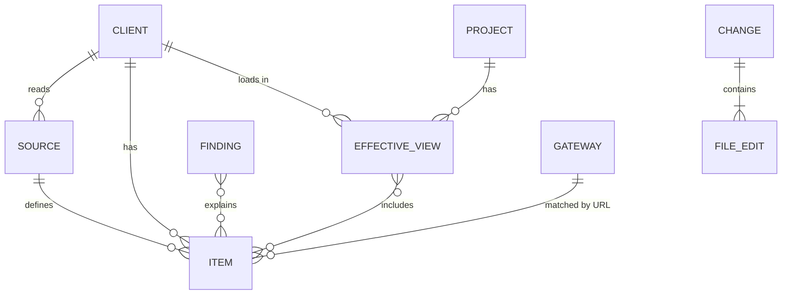
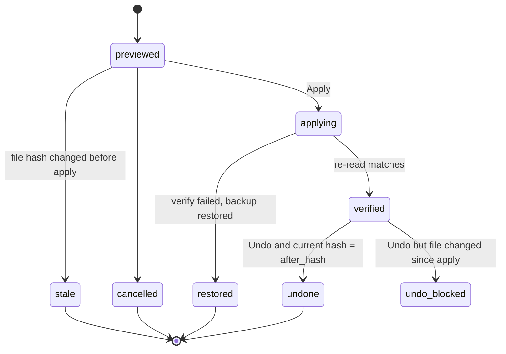

# Data Model: Agent setup inventory and safe controls

**Feature**: [spec.md](spec.md) | **Date**: 2026-10-17 | **Phase**: 1

All data lives in memory during a session, except the change log and backups, which are files
under `~/Library/Application Support/<tool>/` (see [research R7](research.md#r7-safe-write-pattern)).
`<tool>` is a placeholder until the product name is chosen.

## Client

| Field | Type | Rules |
| --- | --- | --- |
| `id` | enum: `claude_code`, `claude_desktop_code_tab`, `codex`, `cursor` | Unique |
| `display_name` | text | |
| `status` | enum: `found`, `not_found`, `unreadable` | `not_found` when no executable and no config root exist |
| `version` | text or null | From the version command or app bundle (research R11); null if unknown |
| `version_supported` | boolean | False when below the minimum in research R11 |
| `config_roots` | list of paths | For example `~/.claude`, `~/.codex`, `~/.cursor` |
| `write_capabilities` | set of capability ids | From the write matrix in [contracts/write-matrix.md](contracts/write-matrix.md); spike-gated capabilities are absent until the spike passes |

## Source

| Field | Type | Rules |
| --- | --- | --- |
| `id` | stable hash of `kind` + `path` + `key_path` | |
| `kind` | enum: `file`, `folder`, `other_client_folder`, `plugin`, `account`, `state_database`, `managed` | `account` sources are never readable |
| `path` | absolute real path or null | Symlinks resolved; original link path kept in `link_path` |
| `key_path` | text or null | For example `projects./repo.mcpServers` |
| `owner_client` | Client id | The client that owns the path; differs from the reading client for cross-loading |
| `read_status` | enum: `ok`, `unknown` | |
| `unknown_reason` | enum or null: `stored_in_account`, `no_access`, `unrecognized_format`, `parse_error`, `may_be_stale`, `not_documented` | Required when `read_status` is `unknown` |
| `content_hash` | SHA-256 or null | Used for change detection and stale checks |

## Scope

Enum: `managed`, `user`, `project`, `local`, `plugin`, `account`. Each client maps its own scope
names onto this list (for example Claude Code "local" means per-project private settings in
`~/.claude.json`).

## Item

| Field | Type | Rules |
| --- | --- | --- |
| `id` | stable hash of `client` + `kind` + `name` + `source.id` | |
| `client` | Client id | The client that loads it |
| `kind` | enum: `mcp_server`, `skill`, `plugin`, `hook`, `marketplace` | |
| `name` | text | Plugin ids keep the `name@marketplace` form |
| `source` | Source id | |
| `scope` | Scope | |
| `project` | Project id or null | Null for user-wide items |
| `enabled` | enum: `on`, `off`, `unknown` | |
| `secret_present` | boolean | True if any field held a secret; the value is never stored in the model |
| `summary` | redacted map | Transport, command or URL with secrets replaced by `[secret]` or `${VAR}` references |
| `via_gateway` | Gateway id or null | Set when the URL matches a registered gateway |
| `actions` | list of action ids | Allowed actions for this item (FR-026 to FR-029, FR-033), from the write matrix |
| `change_hint` | text or null | Where to change the item when the tool cannot, for example Cursor plugins (FR-028) |

**Validation**: an item with `enabled = unknown` must have a source with an `unknown_reason`, or a
finding that explains it.

## Project

| Field | Type | Rules |
| --- | --- | --- |
| `id` | hash of the real path | |
| `path` | absolute path | |
| `exists` | boolean | False when the folder is gone (edge case) |
| `known_by` | list of Client ids | From `~/.claude.json` projects, Codex `[projects]`, Cursor workspaces |
| `trust` | map Client id → `trusted`, `untrusted`, `unknown` | Codex `trust_level`; Claude trust dialog state |

## Effective view

One per (Project, Client). Built by the client's documented rules (research R3).

| Field | Type | Rules |
| --- | --- | --- |
| `project` | Project id | |
| `client` | Client id | |
| `items` | list of Item ids that load | |
| `shadowed` | list of (winning Item id, losing Item id) | Claude: whole entry wins; Codex: field-level merge recorded as a merged item with several sources; Cursor: project wins |
| `built_at` | timestamp | |

## Finding

| Field | Type | Rules |
| --- | --- | --- |
| `id` | hash | |
| `type` | enum: `duplicate_in_client`, `cross_loaded`, `same_in_other_clients`, `scope_override`, `bypasses_gateway`, `unknown_state`, `version_unsupported` | `bypasses_gateway` records whether the server comes from a plugin, is local, or is a direct entry (FR-039) |
| `severity` | enum: `warning`, `info` | `duplicate_in_client` = warning (FR-011); `same_in_other_clients` = info (FR-013); `bypasses_gateway` = info for plugin and local servers, warning for direct entries |
| `items` | list of Item ids | At least one |
| `explanation` | text | Lists every source path involved (FR-012) |

## Change

A user-requested edit to one or more client settings.

| Field | Type | Rules |
| --- | --- | --- |
| `id` | UTC timestamp + short random id | |
| `action` | action id: `gateway.connect`, `mcp.remove_direct`, `plugin.enable`, `plugin.disable`, `setup_server.register` | Must be in the target items' `actions` |
| `targets` | list of (Client id, Scope, Item or new entry) | `gateway.connect` may target several clients |
| `edits` | list of File edit | |
| `mechanism` | enum per edit: `client_cli`, `format_preserving_edit` | From the write matrix |
| `state` | see transitions below | |
| `restart_needed` | map Client id → boolean | FR-023 |
| `shared_file_warning` | boolean | True when an edit touches a file usually committed to git (FR-024) |
| `log_entry` | redacted record | Written to the change log; no secret values (FR-022) |

### File edit

| Field | Type | Rules |
| --- | --- | --- |
| `path` | real path | Hard-linked files are refused |
| `before_hash` | SHA-256 | Recorded at preview |
| `after_hash` | SHA-256 or null | Recorded after apply |
| `backup_path` | path or null | Mode 0600 |
| `masked_diff` | text | Secrets masked |

### Change states

## Gateway

| Field | Type | Rules |
| --- | --- | --- |
| `id` | hash of normalized URL | |
| `url` | MCP endpoint URL | Normalized (scheme, host, port, path) |
| `ui_url` | URL or null | Optional link to the gateway interface (FR-034) |
| `auth` | enum: `none`, `env_key`, `oauth` | `env_key` stores only the variable name; `oauth` shows client login commands (FR-035) |
| `key_env_var` | text or null | Name only, never the value |

Registered gateways are stored in the tool's local settings file (mode 0600).
