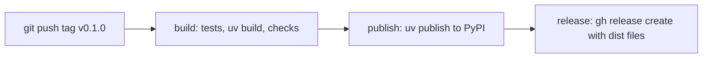

# Contract: checks and releases

One workflow, `.github/workflows/release.yml`. Every push and pull request runs the checks. A
pushed tag `v<version>` that matches `kitden.__version__` also builds and releases.

| Job | Runner | Permissions | Steps | Fails when |
| --- | --- | --- | --- | --- |
| `build` | macOS | `contents: read` | checkout; `astral-sh/setup-uv` (pinned); `uv sync --locked`; `uv run ruff check .`; `uv run pytest -q`; on a tag: the tag equals `v$(uv version --short)`; `uv build`; the wheel lists `kitden/web/static/index.html` and the sdist lists no `tests/`, `docs/`, `specs/`; `uv run --isolated --no-project --with dist/*.whl -- kitden --version` prints the version; upload `dist/` | any step fails |
| `publish` (tags only) | Linux | `id-token: write`, environment `pypi` | download `dist/`; `uv publish --trusted-publishing always dist/*` (PyPI Trusted Publishing: the token is minted for this run and never stored) | PyPI rejects the files, or the version is already on PyPI |
| `release` (tags only) | Linux | `contents: write` | checkout; download `dist/`; `gh release create <tag> dist/* --generate-notes --verify-tag` with `GH_TOKEN: ${{ github.token }}` | the tag is missing on the remote, or the release exists |

Rules:

- A tag push with failing tests publishes nothing (FR-001). `publish` needs `build`; `release` needs both.
- No secret is stored.
- The version string, the tag and the two plugin manifests carry the same number (FR-015); the
  build job checks the tag against the package version.
- The release notes are generated from the commits since the previous tag.
- Running the workflow again for the same tag fails at `release` and changes nothing.

One-time setup on PyPI (a pending trusted publisher) and on GitHub (the `pypi` environment) is in
research R11. Until it is done, the `publish` job fails and nothing is released.
