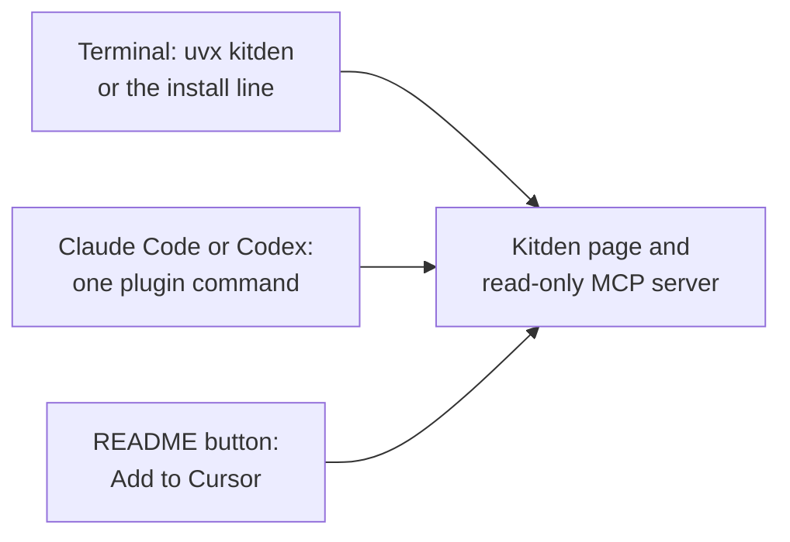

# Feature Specification: One-line install

**Feature Branch**: `003-one-line-install`

**Created**: 2026-10-18

**Status**: Owner decisions taken on 2026-10-18; in implementation

**Input**: Owner, through the planning session: "Make Kitden installable and usable with one line,
following Part B of the [design and install review](../../docs/research/design-and-install-review-2026-10-18.md):
publish to PyPI and GitHub, one install line for the README and the future website, a Claude Code
plugin in the Kitden repository, the same package for Codex, an install button for Cursor. Keep
the MCP server read-only and small."

## Why

Today Kitden needs a clone of the repository, uv, and two commands, on a Mac. The owner wants
"click and use" from any coding agent. The review found three doors that each take one line:
a terminal command, a plugin command inside a coding client, and a button on a web page. All
three lead to the same local engine and page.

Nothing in this feature changes a client's settings on its own. The install line installs a
command. A plugin or a button adds the read-only server only because the user asked the client
for it, and the client asks first.

## User Scenarios & Testing *(mandatory)*

### User Story 1 - Run Kitden with one command, nothing installed (Priority: P1)

A developer who has uv runs one `uvx` command from the GitHub repository. The page opens. Once
Kitden is on PyPI (later), the command shortens to `uvx kitden`. Behind this story, a maintainer
publishes a version by pushing one tag.

**Why this priority**: every other door needs a published package. Without it, the plugin and the
install line have nothing to install.

**Independent Test**: on a clean macOS user account with uv and no Python, run `uvx kitden` and
see the page.

**Acceptance Scenarios**:

1. **Given** uv is installed, **When** the developer runs
   `uvx --from git+https://github.com/KonstantinStarovoytov/kitden kitden`, **Then** the page opens in the
   browser, the link is printed, and no client file changes.
2. **Given** no Python 3.13 or newer is installed, **When** that command runs, **Then** uv fetches
   one and the page still opens.
3. **Given** Kitden is on PyPI (a later release), **When** the developer runs `uvx kitden`,
   **Then** the page opens the same way.
4. **Given** the developer names a version (the `@v0.1.0` tag in the git form), **Then** that
   version runs and `--version` prints it.
5. **Given** the maintainer pushes a version tag, **When** the tests pass, **Then** the version
   appears on the GitHub Releases page with its built files and release notes, with no manual
   upload and no stored password or token. Publishing to PyPI comes later (owner decision).
6. **Given** the tests or the build fail on a tag, **Then** nothing is published.

---

### User Story 2 - Install with one line, even without uv (Priority: P1)

A developer copies one line from the README (later from the website) into a terminal. The line
installs uv when it is missing, installs Kitden, and opens the page. Windows gets a PowerShell
line with the same steps.

**Why this priority**: this is the door for people who do not know uv. It is the line the website
will show.

**Independent Test**: on a clean macOS user account without uv, paste the line and see the page.

**Acceptance Scenarios**:

1. **Given** uv is missing, **When** the line runs, **Then** uv is installed with uv's own
   installer, Kitden is installed as a uv tool, the page opens, and the line ends by printing
   where the `kitden` command is and the one command to add it to PATH when it is not there.
2. **Given** uv is already installed (by Homebrew or by uv's installer), **Then** the line does not
   install uv again.
3. **Given** Kitden is already installed, **Then** the line updates it to the latest release and
   opens the page.
4. **Given** there is no network, **Then** the line stops with a message that names the step that
   failed, and it does not leave a half-installed Kitden.
5. **Given** the system is Linux or Windows, **Then** the line says Kitden does not support that
   system yet, points to the follow-up, and installs nothing.
6. **Given** any run of the line, **Then** no client settings file changes (same bytes before and
   after).

---

### User Story 3 - Install from inside Claude Code (Priority: P2)

Inside Claude Code the developer runs one plugin command. The plugin brings a short skill and the
read-only "show my setup" server. From then on the agent can answer "what loads here" with
Kitden's tools and can open the page on request.

**Why this priority**: it is the owner's main wish, "click and use from any agent", and it needs
the published package from story 1.

**Independent Test**: on a machine with Kitden installed, run the plugin install command in Claude
Code, start a new session, and ask what loads in the current project.

**Acceptance Scenarios**:

1. **Given** Kitden is installed and Claude Code is 2.1.275 or newer, **When** the developer runs
   `/plugin install kitden --marketplace KonstantinStarovoytov/kitden` and accepts, **Then** in the next session
   the kitden tools answer and the skill `/kitden:setup` is listed.
2. **Given** the plugin is installed, **When** the developer asks what loads in this project,
   **Then** the agent answers from the kitden tools and does not read or edit settings files by
   hand.
3. **Given** the plugin is installed, **When** the developer asks the agent to change the setup,
   **Then** the agent sends them to the page (`kitden open`, which returns at once and prints the
   link) and does not edit any settings file.
4. **Given** Kitden is not installed, **When** the plugin is installed, **Then** the client shows
   the server as failed, the skill still loads, and the skill tells the agent to show the install
   line and not to edit anything.
5. **Given** the plugin provides the server, **When** the developer opens Kitden's Agents place,
   **Then** it shows "provided by the kitden plugin" for that client and does not offer to add a
   second entry.
6. **Given** a new Kitden release, **When** the developer updates the plugin, **Then** the plugin
   version equals the package version.

---

### User Story 4 - The same package for Codex, a button for Cursor (Priority: P3)

The developer installs the same plugin in Codex with its marketplace commands. In Cursor, a button
in the README adds the read-only server.

**Why this priority**: the other two supported clients. The plugin folder is shared with story 3,
so the extra work is small, but each client needs a real test.

**Independent Test**: on a machine with Kitden installed, run the two Codex commands and click the
Cursor button; ask each client what loads.

**Acceptance Scenarios**:

1. **Given** Kitden is installed, **When** the developer runs
   `codex plugin marketplace add KonstantinStarovoytov/kitden` and `codex plugin add kitden@kitden`, **Then** in
   the next Codex session the kitden tools answer and the skill is listed.
2. **Given** the README is open, **When** the developer clicks "Add to Cursor" and confirms in
   Cursor, **Then** exactly one MCP entry named `kitden` is added, it starts `kitden mcp`, and the
   rest of the file is unchanged.
3. **Given** a plugin-provided server in Codex, **When** the developer opens Kitden's Agents place,
   **Then** it shows "provided by the kitden plugin" for Codex, as for Claude Code.

---

### Edge Cases

- The uv tool folder (`~/.local/bin`) is not on PATH: the install line still runs `kitden` by its
  full path and prints the one command that fixes PATH.
- uv is installed in a custom place: the line uses the `uv` found on PATH first, then uv's default
  place.
- `uvx kitden` keeps an old cached version: the README says to run `uvx kitden@latest`.
- A client has both the plugin's server and a user-level `kitden` entry: the page shows the
  duplicate and offers to remove the user-level entry, as it does for other duplicates. The
  plugin's entry is removed only by uninstalling the plugin in the client.
- The plugin is installed, but the client cannot find the `kitden` command (Kitden not installed,
  or a client started without the user's shell PATH): the client shows the server as failed; the
  skill says what to do. The Claude Desktop Code tab is checked in the quickstart.
- A tag is pushed twice, or the same version is published twice: the second run fails and
  changes nothing.
- The name `kitden` is taken on PyPI before the first release: the owner is told before the first
  release and chooses another name; nothing in this feature depends on the name except the
  documentation.
- The GitHub repository is private: the plugin can be installed only by people who can clone it.
  PyPI and the install line still work for everyone.
- Old `agentsetup` installs, remote sessions: unchanged, see feature 002.

## Requirements *(mandatory)*

### Functional Requirements

- **FR-001**: Pushing a version tag MUST run the tests, build the package and create a GitHub
  release with the built files and notes. A failed test or build MUST publish nothing. Publishing
  to PyPI is a later step; when it comes, it MUST use no stored secret.
- **FR-002**: The package MUST run the page with `uvx --from git+https://github.com/KonstantinStarovoytov/kitden kitden`
  (and with `uvx kitden` once it is on PyPI), print its version with `--version`, and include
  every file the page needs.
- **FR-003**: The README MUST show the git form of the `uvx` command (pinned to the release tag,
  and the plain form) as the way to run Kitden without installing it. The `uvx kitden` form is
  added when PyPI publishing lands.
- **FR-004**: The package metadata MUST name the license, the project links, the supported system
  and the Python versions. The source distribution MUST contain only what is needed to build and
  run Kitden: no tests, fixtures, specs or research.
- **FR-005**: The repository MUST hold one install script for macOS and Linux and one for Windows,
  each runnable from one line in the README. A script MUST: install uv with uv's own installer
  when uv is missing; install Kitden as a uv tool, or update it when it is already installed;
  open the page; and print where the `kitden` command is and how to add it to PATH when needed.
  The Windows script carries the same steps; until Windows is supported, only the stop of FR-006
  runs there.
- **FR-006**: An install script MUST stop with a clear message before installing anything on a
  system Kitden does not support yet (Linux and Windows today).
- **FR-007**: The install scripts and every command in this feature MUST NOT add, enable or change
  anything in a client's settings. Only the user's own action in a client (plugin install, the
  Cursor button) adds the read-only server, and the client asks first.
- **FR-008**: The repository MUST contain a Claude Code marketplace and a plugin named `kitden`
  with a short skill and the read-only server entry that starts `kitden mcp`, installable with
  `/plugin install kitden --marketplace KonstantinStarovoytov/kitden`.
- **FR-009**: The skill MUST tell the agent: open the page with `kitden open`; answer "what loads"
  questions with the kitden tools; never edit client settings files; when the tools are missing,
  show the install line.
- **FR-010**: The plugin MUST add no hooks, no commands that run by themselves, and no
  executables. Uninstalling it in the client MUST leave every other setting untouched.
- **FR-011**: The same plugin folder MUST be installable in Codex with
  `codex plugin marketplace add KonstantinStarovoytov/kitden` and `codex plugin add kitden@kitden`, and MUST
  give Codex the same skill and server.
- **FR-012**: The README MUST have an "Add to Cursor" button that adds only the kitden server
  entry, plus the plain link for pasting into a browser.
- **FR-013**: The read-only MCP server MUST stay read-only and process-free, as in the feature 002
  contract. This feature adds no tools.
- **FR-014**: Kitden's Agents place MUST recognise a kitden server that a plugin provides
  (Claude Code, Codex) and show it as provided by the plugin instead of offering to add a second
  entry. A user-level entry next to a plugin entry MUST be reported: the page's existing rule shows
  it as the user entry replacing the plugin one, naming both.
- **FR-015**: The plugin version MUST equal the package version. A release MUST update both.
- **FR-016**: The README MUST show, in this order: the install line, `uvx kitden`, the Claude Code
  command, the Codex commands and the Cursor button, and MUST say what each one changes on the
  computer.
- **FR-017**: The README MUST have a short maintainer section: how to release, and the one-time
  steps the owner does outside the code (GitHub repository, PyPI publisher, GitHub environment,
  license).

### Key Entities

- **Release**: one version of Kitden: the tag, the built files, the PyPI page and the GitHub
  release. Made by one tag push.
- **Install script**: the steps system check → uv → Kitden → open the page, and the messages for
  each failure.
- **Plugin package**: the folder in the repository that both Claude Code and Codex install: two
  marketplace entries, the manifests, one skill, one server entry. Its version is the package
  version.
- **Setup server state** (existing, feature 002): per client `added`, `old`, `missing`,
  `not_installed`, plus the new `plugin` state.

## Success Criteria *(mandatory)*

### Measurable Outcomes

- **SC-001**: On a clean macOS account with uv and no Python,
  `uvx --from git+https://github.com/KonstantinStarovoytov/kitden kitden` shows the page in under 2 minutes the
  first time and under 10 seconds the second time.
- **SC-002**: On a clean macOS account without uv, the one install line ends with the page open
  in under 3 minutes, and every client settings file has the same bytes as before.
- **SC-003**: A release is one tag push. GitHub Releases shows the version within 15 minutes,
  and `uvx --from git+https://github.com/KonstantinStarovoytov/kitden@v<version> kitden --version` prints it
  on another machine.
- **SC-004**: In Claude Code, one install command and one new session are enough to get the
  answer to "what loads in this project" from the kitden tools, with no settings file changed.
- **SC-005**: In Codex, two commands and one new session are enough for the same answer, in the
  Codex app and in the CLI.
- **SC-006**: In Cursor, one click and one confirmation add exactly one entry; the rest of the
  file is byte for byte the same.
- **SC-007**: The plugin folder passes Claude Code's strict validation, the source distribution
  holds no test, fixture, spec or research file, and the plugin and package versions match. All
  three are checked by tests.
- **SC-008**: Every client command in the README was run on the real client version named in the
  quickstart, and that version is recorded.

## Owner decisions (2026-10-18)

| Decision | Decided | Effect |
| --- | --- | --- |
| License | Apache-2.0 | `LICENSE` file and the `license` field in the package and plugin manifests |
| GitHub repository | A public repository `KonstantinStarovoytov/kitden` in the owner's personal profile; the owner creates it (login given 2026-10-18) | The plugin commands and the git form of `uvx` point at it; the local folder name stays |
| PyPI | Not now. The git route is the first install path; PyPI publishing is a later task. Register the name `kitden` at the first PyPI release to reserve it | No PyPI account or publisher is needed for this feature |
| First version | 0.1.0, the first public version; 0.1 and 0.2 were working versions never published | `kitden --version` prints 0.1.0; the README says it is the first public version |
| Order against feature 004 | 004 is merged into main; this branch builds on it | No constraint on timing |

## Assumptions

- Kitden runs on macOS only. Linux and Windows support is a follow-up feature; the install
  scripts stop on those systems until then.
- The website comes later. The README is the first home of the install line and the button.
- The client versions used for the checks: Claude Code 2.1.275 or newer for the one-command plugin
  install (the owner has 2.1.283); the Codex CLI shipped with the ChatGPT app (0.163 or newer);
  the current Cursor.
- The plugin's server starts `kitden mcp` from the user's PATH. How the entry is written and what
  happens when the command is missing are plan decisions.
- Not in this feature: a Homebrew tap, Anthropic's or OpenAI's public directories, the MCP
  Registry, a signed binary, a website, and automatic updates of a running page.
