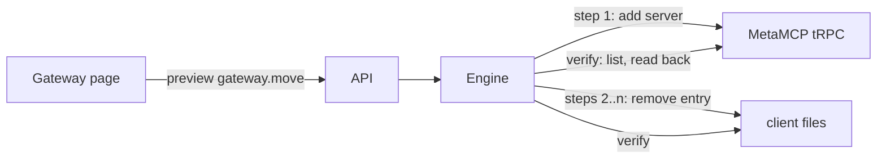

# Plan: Manage the gateway from inside Kitden

Spec: [spec.md](spec.md). Research: [gateway APIs](../../docs/research/gateway-api-2026-10-19.md).

## Technical context

Python 3.13, Starlette, no new dependencies: the gateway client uses `urllib` with a 5 s timeout.
MetaMCP 2.4.22 is the only gateway kind; its calls are the tRPC procedures its own UI uses
(research, table "Calls Kitden needs"). Tests run a fake MetaMCP on `127.0.0.1` in a thread
(`http.server`), never the network.

## Constitution check

- III Safe changes: the file side keeps the engine (backup, verify, undo). The gateway side is
  verified by reading the list back and reversed on failure. The gateway has no CLI; its API is
  the only documented path, so it is used directly.
- IV Honest and private: the password is read from the environment at call time; the record
  keeps the variable's name. Header values pass through `redact` before any diff or log.
- VI Local and simple: one new module for the gateway client, one new step kind in the engine.
- Product boundaries: "gateway first" — Kitden moves servers into the gateway and removes the
  direct entries; it still does not add servers to client files.

## Design

### Data model

| Entity | Change |
| --- | --- |
| `Gateway` | `+ login_email: str \| None`, `+ login_password_env_var: str \| None` (a variable name, validated like `key_env_var`) |
| `GatewayEdit` (new) | `gateway_id`, `url`, `name` (name in the gateway), `server` (type, url, headers — may hold secrets), `before: bool` (held before), `server_uuid`, `after_hash`, `masked_diff` |
| `Step` | `edit: FileEdit \| None`, `+ gateway: GatewayEdit \| None`; a step has exactly one of them; `client` is `"gateway"` for a gateway step |
| `Change` | unchanged; `action = "gateway.move"` |

### Gateway client (`src/kitden/gateway_api.py`)

`MetaMcpClient(gateway, env)`: `sign_in()`, `sign_out()`, `held()` → `[{uuid, name, type, url}]`
for the namespace behind the stored endpoint URL, `add(name, server)` → uuid (create + namespace
update), `remove(uuid)` (namespace update + delete). Every unexpected shape raises
`GatewayError` with a short message free of secrets. `env` defaults to `os.environ`.

### Engine

- Preview: a gateway step reads `held()`; refused when the name is there. `masked_diff` shows
  `+ name` and the redacted address.
- Apply: gateway steps first, then file steps as today. If any later step fails, the gateway
  server is removed again before the files are restored (`restored`).
- Verify: `held()` must contain the server; files as today.
- Undo: file checks first (unchanged); then `remove(uuid)` ("not found" counts as done); then
  the files are written back.
- Record and log: a gateway step is stored with its uuid; the log line's `path` is the gateway URL.

### API

| Call | Change |
| --- | --- |
| `POST /api/gateways` | accepts `login_email`, `login_password_env_var` |
| `GET /api/gateways/{id}/servers` | `{servers: [{name, type, url}]}` or `{error: "…"}`; never blocks the page |
| `POST /api/changes/preview` | action `gateway.move`, `targets: [{item}]`, `params: {gateway}` |
| change JSON | a gateway step has `client: "gateway"`, `path: <gateway url>`, `diff` |

### Page

The gateway card gets "In the gateway · N" rows (name, Details). The move group gets "Move
all N…" in its heading and "Move into the gateway…" per row; "Remove direct entry…" stays
under the row's Details panel as today. The review reuses the existing panel: a gateway step
shows the gateway name as its client. Motion: nothing new; the existing press, fold and
Applied check apply.

## Verification

`uv run pytest -q`, `uv run ruff check .`, `node --test tests/frontend/motion.test.mjs`; the
browser check from [quickstart.md](quickstart.md) in both themes and at 375 px.
