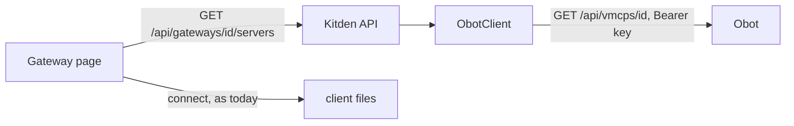

# Plan: Obot as a gateway in Kitden

Spec: [spec.md](spec.md). Calls: [research.md](research.md). Status: **proposal**; Step A
plannable now, Step B only after the re-check in research R4.

## Technical context

Python 3.13, Starlette, no new dependencies: `urllib` with a 5 s timeout, as the MetaMCP
client. Obot v0.26.3 is the version every call was checked against. Tests run a fake Obot on
`127.0.0.1` in a thread (`http.server`), never the network. The real gateway for the browser
check is Docker on the Mac (research note, place (a)).

## Constitution check

- III Safe changes: Step A writes nothing in Obot; client files go through the existing
  connect flow (backup, verify, undo). Step B reuses the feature 006 gateway step.
- IV Honest and private: the key is read from the environment at call time; the record keeps
  the variable's name; error text never carries a response body.
- VI Local and simple: one new client class beside `MetaMcpClient`; the gateway kind is told
  from the address shape, no new field.
- Product boundaries: gateway first; Kitden still adds no individual servers to client files.

## Design (Step A)

### Data model

| Entity | Change |
| --- | --- |
| `Gateway` | unchanged fields: `url` (the connection address), `ui_url`, `auth` (`env_key` or `oauth` for the clients), `key_env_var`. Managed-for-Obot means: the address is an Obot connection address **and** `key_env_var` is set |
| `Gateway.kind` (property, not stored) | `"metamcp"` when the path starts with `/metamcp/`, `"obot"` when it starts with `/mcp-connect/`, else `"other"` |

The MetaMCP sign-in fields stay as they are; the form shows them only for a MetaMCP address
and the key variable for an Obot address.

### Gateway client (`src/kitden/gateway_api.py`)

`ObotClient(gateway, env)`: `check()` → `GET /api/me`; `held()` → `GET /api/vmcps/{id}` and
returns `[{name, kind, url?}]` from `components[]` (kind from the catalog entry's `runtime`,
`url` from `remoteConfig.fixedURL` when present). `Authorization: Bearer <key>` on every call.
Any status other than 200, or a body without `components`, raises `GatewayError` with a short
message free of the body: "Obot could not be reached", "Obot refused the key (401)", "Obot
refused the key (403)", "Obot answered in an unexpected shape (checked against v0.26.3)".

### API and page

`GET /api/gateways/{id}/servers` already exists; it picks the client by `gateway.kind`. The
card shows "In the gateway · N" rows exactly as for MetaMCP; the small link reads "Open Obot ↗";
the review and connect flows are untouched. Motion: nothing new.

## Design (Step B, conditional)

Only if research R4 passes on the day: `ObotClient.add(name, server)` → create a catalog
entry (`POST /api/mcp-catalogs/{catalog}/entries`, admin) or a workspace entry
(`POST /api/workspaces/{ws}/entries`, Power User), then `PUT /api/vmcps/{id}` with the
components plus the new one; `remove()` is the reverse. Address check before the preview
(`localhost`, `127.0.0.0/8`, `::1`, RFC 1918, `169.254/16`, `fc00::/7`, `fe80::/10`). The
engine's `GatewayEdit` step is reused unchanged; `server_uuid` holds the entry id.

## Verification

`uv run pytest -q`, `uv run ruff check .`, `node --test tests/frontend/motion.test.mjs`; the
browser check on a fixture home with the fake Obot, then once against the real Obot in Docker,
in both themes and at 375 px.
